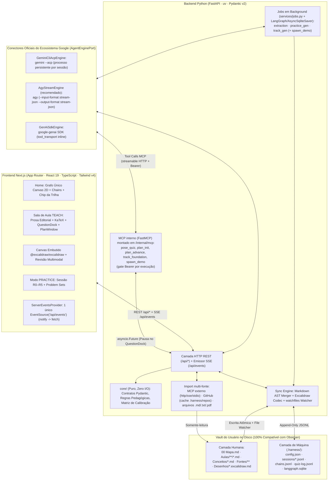

# Lapidare — Arquitetura Técnica e Plano de Construção (`ARCHITECTURE.md`)

Este documento especifica a arquitetura de software, a estrutura de pastas, os protocolos de comunicação (`stream-json`, `ACP`, `FastMCP`, `SSE`), a persistência dupla no Vault e o plano de implementação em duas ondas.

---

## 1. Visão Geral da Arquitetura (Hexagonal + Orquestração Híbrida)



---

## 2. Estrutura de Diretórios do Repositório

```text
/home/lazarodiza/Study/learnharness/
├── README.md
├── AGENTS.md
├── docs/
│   ├── CONTEXT_AND_BEHAVIOR.md        # Contexto e especificação comportamental completa
│   ├── ARCHITECTURE.md                # Este documento técnico
│   └── assets/                        # Mockups e diagramas de referência
├── backend/
│   ├── pyproject.toml                 # Gerenciado via uv (Python 3.12+)
│   └── src/learnharness/
│       ├── core/                      # ZERO I/O: apenas Pydantic models e funções puras
│       │   ├── contracts/
│       │   │   ├── config.py          # HarnessConfig, ModelSlots, VaultFolderMap, McpServerConfig
│       │   │   ├── session.py         # SessionRecord, SessionMessage, PlanDag, PlanNode
│       │   │   ├── quiz.py            # QuizPayload, QuizAnswer, CalibrationResult, ConfidenceBand
│       │   │   ├── graph.py           # ConceptNode, Proposition, LogicalChain, GraphSnapshot
│       │   │   └── practice.py        # PracticeSet, PracticeProblem, RubricCriterion, HintStep
│       │   ├── calibration.py         # Cálculo puro da matriz Acerto x Confiança %
│       │   ├── events.py              # Enum e schemas dos frames SSE (/api/events)
│       │   └── ports.py               # Interfaces (Protocols): AgentEnginePort, VaultPort, ContentMcpPort
│       ├── engines/                   # Adaptadores dos 3 caminhos oficiais do Google
│       │   ├── detector.py            # Auto-detecção de gemini CLI, agy CLI e variáveis de ambiente
│       │   ├── cli_protocol.py        # EngineError + idle_wait (timeout por inatividade suspensível)
│       │   ├── agy_engine.py          # agy stream-json (+ --json-schema + --effort); MCP via .agents/mcp_config.json
│       │   ├── gemini_acp.py          # gemini --acp: JSON-RPC sobre stdio, pool de processos por sessão
│       │   ├── gemini_engine.py       # Base headless (gemini -p --output-format stream-json) reaproveitada pelo agy
│       │   └── genai_sdk_engine.py    # Fallback via pacote oficial google-genai (tools inline)
│       ├── mcp/
│       │   ├── runtime_server.py      # MCP interno (FastMCP) montado em /internal/mcp, tools ligadas à execução
│       │   ├── pending_dock.py        # Registro de asyncio.Future para pausar o turno no QuestionDock
│       │   ├── demo_builder.py        # Geração de simuladores HTML auto-contidos em viz/demos/
│       │   └── content_client.py      # Cliente para QUALQUER servidor MCP de conteúdo (http/sse/stdio)
│       ├── services/
│       │   ├── sessions.py            # Execuções TEACH/PRACTICE, tokens por execução, recuperação
│       │   ├── jobs.py                # Fila de jobs em background (extraction, practice_gen, track_gen)
│       │   ├── tracks.py              # Geração da Trilha (outline do currículo inteiro) + progresso no 00 Mapa.md
│       │   ├── demos.py               # spawn_demo -> viz/demos/*.html + SSE
│       │   └── secrets.py             # Tokens de MCP externos em ~/.config/learnharness/secrets.json (0600)
│       ├── prompts/                   # Prompts modulares numerados (inspirados no learnharness + teach/SKILL.md)
│       │   ├── shared/                # Identidade, idioma (PT-BR/EN), formatação KaTeX/Mermaid, calibração
│       │   ├── prober/                # Diagnóstico rápido + triagem de blocos de aulas densas
│       │   ├── teacher/               # Exemplo concreto -> Definição, Predict/Check, ancoragem #^pN, Trilha 2:1
│       │   └── practice/              # Doutrina R0–R5 e geração commit-before-pose
│       ├── vault/                     # Sincronização Bidirecional UI ⇄ Vault Obsidian
│       │   ├── bootstrap.py           # Criação automática de Vault novo ou adoção não-destrutiva de existente
│       │   ├── markdown_ast.py        # Parser/Merger de seções Markdown e YAML frontmatter
│       │   ├── excalidraw.py          # Leitura/escrita de .excalidraw.md + exportação .png
│       │   ├── jsonl_store.py         # Escrita append-only em .harness/{sessions,chains,quiz-log}.jsonl
│       │   ├── safety.py              # safe_path, escrita atômica e locks (nada escapa do Vault)
│       │   ├── transcript_importer.py # Fontes/ com parágrafos ^pN + frontmatter de proveniência
│       │   ├── github_source.py       # Clone raso em cache (.harness/repos) + listagem/import de repositórios
│       │   └── watcher.py             # Monitoramento assíncrono via watchfiles emitindo SSE "vault:changed"
│       ├── pipelines/                 # (Onda 2) Esteiras em background com LangGraph
│       │   ├── extraction.py          # StateGraph: Extractor -> Auditor -> Merger (Conceitos/*.md + chains.jsonl)
│       │   └── practice_gen.py        # StateGraph: Partitioner -> Send(Generator) -> Grader
│       └── api/                       # Servidor HTTP FastAPI
│           ├── app.py                 # App factory, lifespan, CORS, guarda Host/Origin, montagem do MCP interno
│           ├── sse.py                 # Hub SSE único (/api/events)
│           └── routes/                # /api/setup, /api/chats, /api/graph, /api/import(/github,/local,/mcp), /api/drawings
├── scripts/dev.sh                     # Sobe backend + frontend com portas configuráveis
├── Makefile                           # make dev | make check
└── frontend/                          # Aplicação Next.js (App Router, React 19, TypeScript, Tailwind CSS v4)
    ├── package.json
    ├── next.config.ts                 # Proxy rewrites de /api/* para http://127.0.0.1:8000/api/*
    ├── public/fonts/                  # CMU Serif Bold (cmunbx.ttf) local
    ├── app/
    │   ├── globals.css                # Tokens "The Skin" (#1a1430, #231b3e, #54458a, tipografia modular)
    │   ├── layout.tsx                 # ServerEventsProvider + SidebarProvider + fontes JetBrains/SourceSans3
    │   ├── page.tsx                   # Home (Grafo Único + Top Pills + Chip da Trilha + Composer)
    │   ├── chat/[id]/page.tsx         # Sala de Aula TEACH / Sessão PRACTICE Interativa
    │   ├── draw/[slug]/page.tsx       # Editor @excalidraw/excalidraw embutido + Revisão Multimodal
    │   └── settings/page.tsx          # Configuração de Conectores Google, Vault, Trilha, MCP e Idioma
    └── components/
        ├── graph-canvas.ts            # Renderizador Canvas 2D (clusters nebulosos, pan/zoom, seleção)
        ├── graph-view.tsx             # Wrapper do Grafo + popover de nó + tabela Chains
        ├── sidebar.tsx                # Sidebar recolhível (TEACHING | PRACTICE | ALL + Background Agents)
        ├── composer.tsx               # Caixa de entrada com chip da Trilha, seletor TEACH/PRACTICE e Dictate
        ├── question-dock.tsx          # Cartão PREDICTION / CHECK com KaTeX, slider Confidence e Your Thinking
        ├── plan-window.tsx            # Mini-DAG flutuante no canto inferior direito da aula
        ├── source-citation-pane.tsx   # Painel lateral que exibe o parágrafo #^pN original ao clicar numa citação
        ├── import-dialog.tsx          # Modal de importação: abas MCP, GitHub e arquivo local
        ├── mcp-server-manager.tsx     # Cadastro/teste de servidores MCP de conteúdo nas Configurações
        ├── excalidraw-canvas.tsx      # Integração @excalidraw/excalidraw 1:1 com o Vault
        └── server-events.tsx          # Cliente EventSource('/api/events') único com resync automático
```

---

## 3. Detalhamento dos Subsistemas Críticos

### 3.1 Os 3 Conectores Google (`AgentEnginePort`)
Todos os conectores implementam a mesma interface assíncrona em Python (`stream_turn` para conversa com streaming de deltas + tool calls, e `run_structured` para saídas JSON tipadas por `Pydantic`) e declaram um **`tool_transport`**, que diz ao runner de sessão como as tools pedagógicas chegam ao modelo:

- **`"mcp"`** (`agy`, `gemini`): o motor descobre as tools no **MCP interno** (`/internal/mcp`, ver 3.4), configurado por `configure_runtime(work_dir, mcp_url, mcp_token)`.
- **`"inline"`** (`google-genai`): o runner passa as funções Python diretamente em `stream_turn(tools=[...])`; nenhum servidor MCP é necessário.

A seleção é explícita (`engines/get_engine`): não existe troca silenciosa de provedor quando um conector falha.

1. **`AgyStreamEngine` (`agy_engine.py`) — conector recomendado:**
   - Executa `agy --input-format stream-json --output-format stream-json` (+ `--json-schema` / `--effort` em chamadas estruturadas). O MCP interno é registrado em `<work_dir>/.agents/mcp_config.json` (permissão `0600`) com o token da execução corrente.
2. **`GeminiCliAcpEngine` (`gemini_acp.py`):**
   - Usa `gemini --acp` (Agent Client Protocol, JSON-RPC 2.0 sobre `stdio`), com **um processo persistente por sessão** mantido num pool (`AcpProcessPool`, fechado após 10 min ocioso e no shutdown da app). O MCP interno é passado em `session/new` (`mcpServers: [{type: "http", url, headers}]`), então o **token nunca é gravado em disco**. Os fatos do protocolo foram verificados contra o gemini-cli 0.62.0 (`tests/fixtures/acp/`).
   - **Achado importante:** a partir do gemini-cli **0.62**, contas individuais do *Gemini Code Assist* (login Google pessoal) são bloqueadas pelo próprio CLI com a mensagem para *migrar para o Antigravity*. Por isso o **`agy` é o CLI recomendado** para quem usa a assinatura pessoal; o `gemini --acp` segue suportado para contas Workspace/Code Assist Standard e chave de API.
3. **`GenAiSdkEngine` (`genai_sdk_engine.py`):**
   - Utiliza o SDK oficial `google-genai` (`GEMINI_API_KEY` ou Vertex AI) com `tool_transport = "inline"` e `response_schema` para saídas estruturadas.

### 3.2 A Pausa do Turno no `QuestionDock` (`pending_dock.py`)
Para que o agente pare imediatamente após lançar um quiz (`PREDICTION` ou `CHECK`) e reaja no mesmo turno assim que o aprendiz responder:
1. O agente chama a tool MCP `pose_quiz(mode, question, choices, correct_index)`.
2. O handler da tool no `FastMCP`:
   - Grava o estado `quiz_pending` em `.harness/sessions/<id>.jsonl` (garantindo que um reload da página recupere o cartão aberto);
   - Dispara o frame SSE `session:updated` para a UI abrir o `QuestionDock`;
   - Cria um `asyncio.Future` em memória (`pending_quizzes[session_id]`) e faz `await future`.
3. Quando o usuário preenche sua escolha, o slider de **Confiança (`0–100%`)** e o campo **Your Thinking** na UI e clica em `Submit answer`:
   - A rota `POST /api/chats/<id>/answer` calcula a calibração (`calibration.py`), grava em `.harness/quiz-log.jsonl` e chama `future.set_result(...)`.
   - A tool MCP retorna o JSON `{correct, chosen_index, confidence, calibration_band, learner_thinking}` para o processo `agy`/`gemini`, que continua a explicação imediatamente levando em conta o raciocínio exato do aluno.

### 3.3 Sincronização do Grafo Único (`Conceitos/*.md` + `.harness/chains.jsonl`)
Para manter **um único grafo limpo na UI** e ao mesmo tempo **notas legíveis no Obsidian**:
- Cada conceito principal possui um arquivo `Conceitos/<Nome>.md` com YAML frontmatter (`id`, `aliases`, `status`, `depende_de`) e seções humanas (*Intuição*, *Definição Formal*, *Exemplos*, *Proposições & Cadeias*).
- Os metadados finos de renderização do Canvas 2D (coordenadas `(x, y)` salvas pelo layout físico, cores de *hull* da sessão de origem e arestas de implicação composta $A \land B \implies C$) ficam indexados em `.harness/chains.jsonl`.
- A rota `GET /api/graph` combina a leitura de `Conceitos/*.md` com `.harness/chains.jsonl` num único `GraphSnapshot` entregue para o Canvas 2D da Home.

### 3.4 MCP Interno em `/internal/mcp` e o Gate de Token por Execução
- O servidor `FastMCP` (`mcp/runtime_server.py`) é montado **dentro do próprio FastAPI** em `/internal/mcp` (streamable HTTP, `stateless_http=True`); não há processo MCP separado. A URL anunciada aos motores vem de `LEARNHARNESS_MCP_URL` ou de `http://127.0.0.1:${LEARNHARNESS_PORT}/internal/mcp/`.
- Cada execução de sessão recebe um **token Bearer próprio** (`AppState.issue_token(session_id, execution_id)`). O `ExecutionTokenGate` rejeita com `401` qualquer requisição MCP sem token vivo (nem listar tools é possível), e cada tool revalida a ligação: um token de execução antiga (`execution_id` diferente) recebe `PermissionError`.
- Tools expostas: `pose_quiz`, `plan_init`, `plan_advance`, `track_foundation`, `spawn_demo`. Elas sempre agem sobre a sessão ligada ao token, nunca sobre estado global.

### 3.5 Timeout por Inatividade (Suspenso Durante o `QuestionDock`)
- Os motores CLI não têm teto de tempo total: aulas longas bloqueiam legitimamente. O que existe é um **timeout de inatividade** (`cli_protocol.idle_wait`): segundos sem nenhum evento do provedor (linha no `stdout` ou tráfego ACP).
- Enquanto há um `pose_quiz` pendente no `QuestionDock` (`dock_registry.get_pending_quiz(session_id)`), o relógio fica **suspenso**: o aluno pode pensar quanto quiser sem que o turno seja derrubado. Ao responder, o relógio volta a contar do zero.

### 3.6 Jobs em Background
`services/jobs.py` mantém uma fila com semáforo, persistida em `.harness/jobs.jsonl`, recuperada no startup e anunciada via SSE (`~ BACKGROUND AGENTS` na sidebar). Tipos de job:
- **`extraction`** — `pipelines/extraction.py` (`Extractor -> Auditor -> Merger`), atualiza `Conceitos/*.md` + `chains.jsonl` e emite `graph:updated`.
- **`practice_gen`** — `pipelines/practice_gen.py` (`Partitioner -> Send(Generators) -> Grader`) gera *Problem Sets* a partir do `quiz-log.jsonl`.
- **`track_gen`** — `TrackService.generate`: monta um **outline compacto do currículo inteiro** (documentos de estrutura como `README`/`ROADMAP`/`LEARNING.md`/`learning-paths/` primeiro; depois cada lição em ordem natural como `caminho — título: primeiro parágrafo`, incluindo títulos de `.txt`/`.ipynb`), degradando o detalhe por orçamento de caracteres em vez de cortar o repositório; valida ids, pré-requisitos e `source_ref` dentro do repositório.
- **demo builder** — a tool `spawn_demo` (`services/demos.py` + `mcp/demo_builder.py`) grava simuladores auto-contidos em `viz/demos/*.html`, anunciados por SSE e renderizados em iframe na aula.

### 3.7 Import Multi-fonte (`↑ Import`)
Tudo o que é importado vai para `Fontes/` (somente-leitura), com parágrafos `^pN` e frontmatter de proveniência (`source_kind: mcp|github|local`, URL/servidor, `commit`, `imported_at`). Reimportar cria nova versão imutável. Conteúdo remoto é **dado, não instrução**.
- **MCP genérico** (`mcp/content_client.py`, rotas `/api/import/mcp/servers*`): qualquer servidor por `http` (streamable), `sse` ou `stdio`, com conexão por chamada e timeout. Itens vêm do `catalog_tool` configurado ou de `resources/list`. **Segredos ficam fora do Vault**: tokens em `~/.config/learnharness/secrets.json` (`0600`, respeita `XDG_CONFIG_HOME`) ou referenciados por nome de variável de ambiente; `.harness/config.json` guarda só `auth_ref`, e o token nunca volta nas respostas da API. Em `stdio`, o token chega ao processo só por variável de ambiente, nunca por `argv`.
- **GitHub** (`vault/github_source.py`, rotas `/api/import/github/{preview,import}`): só URLs `https://github.com/<owner>/<repo>[/tree|/blob/...]` com validação estrita; `git` roda sem shell, com `--` antes dos posicionais, ambiente limpo (`GIT_TERMINAL_PROMPT=0`, sem `GIT_*` herdado), só o protocolo da URL permitido, symlinks como arquivos comuns, sem submódulos, com timeout e limite de tamanho. Token (`GITHUB_TOKEN`/`GH_TOKEN` ou `gh auth token`) vai por `GIT_CONFIG_*` no ambiente, nunca em `argv` nem em `.git/config`, e é redigido das mensagens de erro.
  - **Cache em `<vault>/.harness/repos/<owner>__<repo>@<ref>/`:** o preview faz um único `git ls-remote` e reaproveita o clone quando o commit remoto é o mesmo; só re-clona (diretório temporário + troca atômica sob lock) quando o commit mudou, o cache falta/está corrompido, ou o corpo traz `refresh: true`. Sem rede, o cache existente continua servindo. O import reaproveita o clone do preview sem tocar a rede.
  - `use_as_track` aponta `config.track.repo_path` para o clone e dispara o job `track_gen` (sem modo novo).
- **Arquivos locais** (`/api/import/local`): `.md`, `.txt` e `.pdf` (texto extraído com `pypdf`), até 20 MB.

### 3.8 Proteção da API Local (Host/Origin)
A API escreve no disco e pode registrar servidores MCP `stdio` (ou seja, executar comandos locais). O `LocalRequestGuard` bloqueia *DNS rebinding* e escrita *cross-site*: o `Host` precisa ser loopback (`LEARNHARNESS_ALLOWED_HOSTS`, padrão `localhost,127.0.0.1,::1`), senão `421`; requisições que alteram estado e trazem `Origin` só passam se a origem estiver em `LEARNHARNESS_CORS_ORIGINS` (o frontend configurado), senão `403`. Erros de motor são redigidos (`AppState.redact`) antes de chegar à UI.

### 3.9 Rodando em Desenvolvimento (`scripts/dev.sh`)
`scripts/dev.sh` (ou `make dev`) sobe backend (`uvicorn`, `127.0.0.1:$BACKEND_PORT`) e frontend (`next dev`, `$FRONTEND_PORT`), recusa portas ocupadas com uma sugestão de alternativa, exporta `LEARNHARNESS_PORT` (para o MCP interno anunciar a URL certa) e `LEARNHARNESS_CORS_ORIGINS` (para a guarda de Origin aceitar o frontend), e aponta o proxy do Next (`BACKEND_URL`) para o backend. `make check` roda `pytest` + `ruff` no backend e `typecheck` + `test` + `build` no frontend.

---

## 4. Plano de Implementação (Onda 1 $\rightarrow$ Onda 2)

### 🚀 Onda 1 — MVP Funcional de Ponta a Ponta
| Etapa | Entregável | Critério de Pronto (Verificação) |
|---|---|---|
| **1.1 Fundação & Skin** | Monorepo `backend/` (`FastAPI` + `uv`) + `frontend/` (`Next.js` + Tailwind v4 + `#1a1430` + `CMU Serif` / `Source Sans 3` / `JetBrains Mono`) + canal SSE `/api/events` | `uv run` + `npm run dev` sobem sem erros; conexão SSE reconecta sozinha e respeita 100% os tokens `#1a1430` / `#231b3e` / `#54458a`. |
| **1.2 Setup & Vault** | `detector.py` (auto-detecção `agy` / `gemini` / `API`) + `vault/bootstrap.py` (criação de Vault novo ou adoção de `~/Documents/AI Engineering`) + `SetupDialog` (Conector, Vault, MCP, Trilha) | Onboarding detecta sua assinatura Google, adota seu Vault existente sem alterar notas e grava `.harness/config.json`. |
| **1.3 Home Unificada** | `graph-view.tsx` (Canvas 2D único + `Chains`) + `import-dialog.tsx` (integração MCP Praxis / Notas locais) + `composer.tsx` (Chip da Trilha ativa + `TEACH \| PRACTICE` + Ditado Zero-Key) | Grafo renderiza os conceitos do Vault; botão `Import` lista aulas do MCP; chip da Trilha mostra o próximo passo do `00 Mapa.md` / `LEARNING.md`. |
| **1.4 Sala de Aula `TEACH`** | `AgyStreamEngine` & `GeminiAcpEngine` + `FastMCP` (`pose_quiz`, `plan_init`, `plan_advance`) + `/chat/[id]` (`QuestionDock` com KaTeX + Confiança % + *Your Thinking*, `PlanWindow` mini-DAG, painel `#^pN`) + escrita não-destrutiva em `Aulas/*.md` | Sessão completa de estudo funciona sobre assinatura Google, pausa no `QuestionDock`, grava em `quiz-log.jsonl` e atualiza a nota da aula no Obsidian em tempo real. |
| **1.5 Excalidraw & Visão** | Rota `/draw/[slug]` com `@excalidraw/excalidraw` embutido lendo/gravando `Desenhos/*.excalidraw.md` + `.png` e botão `[ Revisar meu desenho ]` via visão multimodal | Desenho feito na UI abre igual no Obsidian (e vice-versa); botão de revisão analisa o `.png` e dispara quiz se encontrar erro conceitual. |

### ⚙️ Onda 2 — Motores `LangGraph` em Background e Demos Interativos
| Etapa | Entregável | Critério de Pronto (Verificação) |
|---|---|---|
| **2.1 Extração `LangGraph`** | `pipelines/extraction.py` (`StateGraph`: `Extractor -> Auditor -> Merger` com `AsyncSqliteSaver`) rodando ao final de blocos/aulas | Ao concluir um bloco no `TEACH`, o job aparece em `~ BACKGROUND AGENTS`, atualiza `Conceitos/*.md` + `.harness/chains.jsonl` e acende novos nós no Grafo via SSE. |
| **2.2 Motor `PRACTICE`** | Sessão interativa com escada de dicas `R0–R5` + `pipelines/practice_gen.py` (`StateGraph` com `Send` paralelo gerando *Problem Sets* focados nos erros do `quiz-log.jsonl`) | Modo `PRACTICE` gera listas com rubrica *commit-before-pose*, corrige de `0–10` e conduz treino socrático `R0–R5`. |
| **2.3 `Demo-Builder`** | Subagente gerador de micro-simuladores HTML/JS/Canvas auto-contidos salvos em `viz/demos/*.html` e renderizados em iframe na aula | O `Teacher` consegue invocar `spawn_demo` para criar visualizações matemáticas interativas dentro da prosa da aula. |
