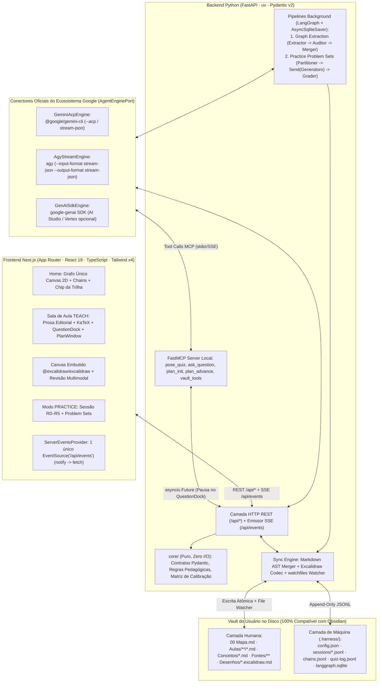

# Arquitetura Técnica e Plano de Construção (`ARCHITECTURE.md`)

Este documento especifica a arquitetura de software, a estrutura de pastas, os protocolos de comunicação (`stream-json`, `ACP`, `FastMCP`, `SSE`), a persistência dupla no Vault e o plano de implementação em duas ondas.

---

## 1. Visão Geral da Arquitetura (Hexagonal + Orquestração Híbrida)



---

## 2. Estrutura de Diretórios do Repositório

```text
/home/lazarodiza/Study/learnharness/
├── README.md
├── AGENTS.md
├── docs/
│   ├── CONTEXT_AND_BEHAVIOR.md        # Contexto e especificação comportamental completa
│   ├── ARCHITECTURE.md                # Este documento técnico
│   └── assets/                        # Mockups e diagramas de referência
├── backend/
│   ├── pyproject.toml                 # Gerenciado via uv (Python 3.12+)
│   └── src/learnharness/
│       ├── core/                      # ZERO I/O: apenas Pydantic models e funções puras
│       │   ├── contracts/
│       │   │   ├── config.py          # HarnessConfig, ModelSlots, VaultFolderMap, McpServerConfig
│       │   │   ├── session.py         # SessionRecord, SessionMessage, PlanDag, PlanNode
│       │   │   ├── quiz.py            # QuizPayload, QuizAnswer, CalibrationResult, ConfidenceBand
│       │   │   ├── graph.py           # ConceptNode, Proposition, LogicalChain, GraphSnapshot
│       │   │   └── practice.py        # PracticeSet, PracticeProblem, RubricCriterion, HintStep
│       │   ├── calibration.py         # Cálculo puro da matriz Acerto x Confiança %
│       │   ├── events.py              # Enum e schemas dos frames SSE (/api/events)
│       │   └── ports.py               # Interfaces (Protocols): AgentEnginePort, VaultPort, ContentMcpPort
│       ├── engines/                   # Adaptadores dos 3 caminhos oficiais do Google
│       │   ├── detector.py            # Auto-detecção de gemini CLI, agy CLI e variáveis de ambiente
│       │   ├── agy_engine.py          # Subprocesso persistente agy (stream-json + --json-schema + --effort)
│       │   ├── gemini_engine.py       # Subprocesso @google/gemini-cli (--acp / stream-json)
│       │   └── genai_sdk_engine.py    # Fallback via pacote oficial google-genai
│       ├── mcp/                       # Servidor FastMCP exposto para o agente ao vivo
│       │   ├── server.py              # Instância FastMCP + registro de tools por fase (Prober vs Teacher)
│       │   ├── pending_dock.py        # Registro de asyncio.Future para pausar o turno no QuestionDock
│       │   └── content_client.py      # Cliente MCP para buscar aulas em servidores externos (ex.: Praxis)
│       ├── prompts/                   # Prompts modulares numerados (inspirados no learnharness + teach/SKILL.md)
│       │   ├── shared/                # Identidade, idioma (PT-BR/EN), formatação KaTeX/Mermaid, calibração
│       │   ├── prober/                # Diagnóstico rápido + triagem de blocos de aulas densas
│       │   ├── teacher/               # Exemplo concreto -> Definição, Predict/Check, ancoragem #^pN, Trilha 2:1
│       │   └── practice/              # Doutrina R0–R5 e geração commit-before-pose
│       ├── vault/                     # Sincronização Bidirecional UI ⇄ Vault Obsidian
│       │   ├── bootstrap.py           # Criação automática de Vault novo ou adoção não-destrutiva de existente
│       │   ├── markdown_ast.py        # Parser/Merger de seções Markdown e YAML frontmatter
│       │   ├── excalidraw.py          # Leitura/escrita de .excalidraw.md + exportação .png
│       │   ├── jsonl_store.py         # Escrita append-only em .harness/{sessions,chains,quiz-log}.jsonl
│       │   └── watcher.py             # Monitoramento assíncrono via watchfiles emitindo SSE "vault:changed"
│       ├── pipelines/                 # (Onda 2) Esteiras em background com LangGraph
│       │   ├── extraction.py          # StateGraph: Extractor -> Auditor -> Merger (Conceitos/*.md + chains.jsonl)
│       │   └── practice_gen.py        # StateGraph: Partitioner -> Send(Generator) -> Grader
│       └── api/                       # Servidor HTTP FastAPI
│           ├── app.py                 # App factory, ciclo de vida (lifespan) e CORS
│           ├── sse.py                 # Hub SSE único (/api/events)
│           └── routes/                # /api/setup, /api/chats, /api/graph, /api/import, /api/drawings
└── frontend/                          # Aplicação Next.js (App Router, React 19, TypeScript, Tailwind CSS v4)
    ├── package.json
    ├── next.config.ts                 # Proxy rewrites de /api/* para http://127.0.0.1:8000/api/*
    ├── public/fonts/                  # CMU Serif Bold (cmunbx.ttf) local
    ├── app/
    │   ├── globals.css                # Tokens "The Skin" (#141414, #1c1c1c, #434343, tipografia modular)
    │   ├── layout.tsx                 # ServerEventsProvider + SidebarProvider + fontes JetBrains/SourceSans3
    │   ├── page.tsx                   # Home (Grafo Único + Top Pills + Chip da Trilha + Composer)
    │   ├── chat/[id]/page.tsx         # Sala de Aula TEACH / Sessão PRACTICE Interativa
    │   ├── draw/[slug]/page.tsx       # Editor @excalidraw/excalidraw embutido + Revisão Multimodal
    │   └── settings/page.tsx          # Configuração de Conectores Google, Vault, Trilha, MCP e Idioma
    └── components/
        ├── graph-canvas.ts            # Renderizador Canvas 2D (clusters nebulosos, pan/zoom, seleção)
        ├── graph-view.tsx             # Wrapper do Grafo + popover de nó + tabela Chains
        ├── sidebar.tsx                # Sidebar recolhível (TEACHING | PRACTICE | ALL + Background Agents)
        ├── composer.tsx               # Caixa de entrada com chip da Trilha, seletor TEACH/PRACTICE e Dictate
        ├── question-dock.tsx          # Cartão PREDICTION / CHECK com KaTeX, slider Confidence e Your Thinking
        ├── plan-window.tsx            # Mini-DAG flutuante no canto inferior direito da aula
        ├── source-citation-pane.tsx   # Painel lateral que exibe o parágrafo #^pN original ao clicar numa citação
        ├── import-dialog.tsx          # Modal de importação (catálogo MCP conectado ou notas/arquivos locais)
        ├── excalidraw-canvas.tsx      # Integração @excalidraw/excalidraw 1:1 com o Vault
        └── server-events.tsx          # Cliente EventSource('/api/events') único com resync automático
```

---

## 3. Detalhamento dos Subsistemas Críticos

### 3.1 Os 3 Conectores Google (`AgentEnginePort`)
Todos os conectores implementam a mesma interface assíncrona em Python (`stream_turn` para conversa com streaming de deltas + tool calls MCP, e `run_structured` para saídas JSON tipadas por `Pydantic`):

1. **`AgyStreamEngine` (`agy_engine.py`):**
   - Para sessões ao vivo: inicia `agy --input-format stream-json --output-format stream-json --mode agent --effort <level>`, registrando o servidor `FastMCP` local. Envia turnos como objetos JSON por linha no `stdin` e consome eventos `step_update` no `stdout`.
   - Para chamadas estruturadas rápidas ou nós do `LangGraph`: executa `agy -p "<prompt>" --output-format json --json-schema <schema.json>`.
2. **`GeminiAcpEngine` (`gemini_engine.py`):**
   - Utiliza `@google/gemini-cli` autenticado com a conta Google do usuário via `gemini --acp` (protocolo JSON-RPC bidirecional sobre `stdio`) ou `gemini -p "..." --output-format stream-json --resume <session_id>`, também conectado ao servidor `FastMCP` local.
3. **`GenAiSdkEngine` (`genai_sdk_engine.py`):**
   - Utiliza o SDK oficial `google-genai` (`client.aio.models.generate_content_stream`), passando as ferramentas do `FastMCP` diretamente em `GenerateContentConfig(tools=[...])` e `response_schema` para saídas estruturadas.

### 3.2 A Pausa do Turno no `QuestionDock` (`pending_dock.py`)
Para que o agente pare imediatamente após lançar um quiz (`PREDICTION` ou `CHECK`) e reaja no mesmo turno assim que o aprendiz responder:
1. O agente chama a tool MCP `pose_quiz(mode, question, choices, correct_index)`.
2. O handler da tool no `FastMCP`:
   - Grava o estado `quiz_pending` em `.harness/sessions/<id>.jsonl` (garantindo que um reload da página recupere o cartão aberto);
   - Dispara o frame SSE `session:updated` para a UI abrir o `QuestionDock`;
   - Cria um `asyncio.Future` em memória (`pending_quizzes[session_id]`) e faz `await future`.
3. Quando o usuário preenche sua escolha, o slider de **Confiança (`0–100%`)** e o campo **Your Thinking** na UI e clica em `Submit answer`:
   - A rota `POST /api/chats/<id>/answer` calcula a calibração (`calibration.py`), grava em `.harness/quiz-log.jsonl` e chama `future.set_result(...)`.
   - A tool MCP retorna o JSON `{correct, chosen_index, confidence, calibration_band, learner_thinking}` para o processo `agy`/`gemini`, que continua a explicação imediatamente levando em conta o raciocínio exato do aluno.

### 3.3 Sincronização do Grafo Único (`Conceitos/*.md` + `.harness/chains.jsonl`)
Para manter **um único grafo limpo na UI** e ao mesmo tempo **notas legíveis no Obsidian**:
- Cada conceito principal possui um arquivo `Conceitos/<Nome>.md` com YAML frontmatter (`id`, `aliases`, `status`, `depende_de`) e seções humanas (*Intuição*, *Definição Formal*, *Exemplos*, *Proposições & Cadeias*).
- Os metadados finos de renderização do Canvas 2D (coordenadas `(x, y)` salvas pelo layout físico, cores de *hull* da sessão de origem e arestas de implicação composta $A \land B \implies C$) ficam indexados em `.harness/chains.jsonl`.
- A rota `GET /api/graph` combina a leitura de `Conceitos/*.md` com `.harness/chains.jsonl` num único `GraphSnapshot` entregue para o Canvas 2D da Home.

---

## 4. Plano de Implementação (Onda 1 $\rightarrow$ Onda 2)

### 🚀 Onda 1 — MVP Funcional de Ponta a Ponta
| Etapa | Entregável | Critério de Pronto (Verificação) |
|---|---|---|
| **1.1 Fundação & Skin** | Monorepo `backend/` (`FastAPI` + `uv`) + `frontend/` (`Next.js` + Tailwind v4 + `#141414` + `CMU Serif` / `Source Sans 3` / `JetBrains Mono`) + canal SSE `/api/events` | `uv run` + `npm run dev` sobem sem erros; conexão SSE reconecta sozinha e respeita 100% os tokens `#141414` / `#1c1c1c` / `#434343`. |
| **1.2 Setup & Vault** | `detector.py` (auto-detecção `agy` / `gemini` / `API`) + `vault/bootstrap.py` (criação de Vault novo ou adoção de `~/Documents/AI Engineering`) + `SetupDialog` (Conector, Vault, MCP, Trilha) | Onboarding detecta sua assinatura Google, adota seu Vault existente sem alterar notas e grava `.harness/config.json`. |
| **1.3 Home Unificada** | `graph-view.tsx` (Canvas 2D único + `Chains`) + `import-dialog.tsx` (integração MCP Praxis / Notas locais) + `composer.tsx` (Chip da Trilha ativa + `TEACH \| PRACTICE` + Ditado Zero-Key) | Grafo renderiza os conceitos do Vault; botão `Import` lista aulas do MCP; chip da Trilha mostra o próximo passo do `00 Mapa.md` / `LEARNING.md`. |
| **1.4 Sala de Aula `TEACH`** | `AgyStreamEngine` & `GeminiAcpEngine` + `FastMCP` (`pose_quiz`, `plan_init`, `plan_advance`) + `/chat/[id]` (`QuestionDock` com KaTeX + Confiança % + *Your Thinking*, `PlanWindow` mini-DAG, painel `#^pN`) + escrita não-destrutiva em `Aulas/*.md` | Sessão completa de estudo funciona sobre assinatura Google, pausa no `QuestionDock`, grava em `quiz-log.jsonl` e atualiza a nota da aula no Obsidian em tempo real. |
| **1.5 Excalidraw & Visão** | Rota `/draw/[slug]` com `@excalidraw/excalidraw` embutido lendo/gravando `Desenhos/*.excalidraw.md` + `.png` e botão `[ Revisar meu desenho ]` via visão multimodal | Desenho feito na UI abre igual no Obsidian (e vice-versa); botão de revisão analisa o `.png` e dispara quiz se encontrar erro conceitual. |

### ⚙️ Onda 2 — Motores `LangGraph` em Background e Demos Interativos
| Etapa | Entregável | Critério de Pronto (Verificação) |
|---|---|---|
| **2.1 Extração `LangGraph`** | `pipelines/extraction.py` (`StateGraph`: `Extractor -> Auditor -> Merger` com `AsyncSqliteSaver`) rodando ao final de blocos/aulas | Ao concluir um bloco no `TEACH`, o job aparece em `~ BACKGROUND AGENTS`, atualiza `Conceitos/*.md` + `.harness/chains.jsonl` e acende novos nós no Grafo via SSE. |
| **2.2 Motor `PRACTICE`** | Sessão interativa com escada de dicas `R0–R5` + `pipelines/practice_gen.py` (`StateGraph` com `Send` paralelo gerando *Problem Sets* focados nos erros do `quiz-log.jsonl`) | Modo `PRACTICE` gera listas com rubrica *commit-before-pose*, corrige de `0–10` e conduz treino socrático `R0–R5`. |
| **2.3 `Demo-Builder`** | Subagente gerador de micro-simuladores HTML/JS/Canvas auto-contidos salvos em `viz/demos/*.html` e renderizados em iframe na aula | O `Teacher` consegue invocar `spawn_demo` para criar visualizações matemáticas interativas dentro da prosa da aula. |
