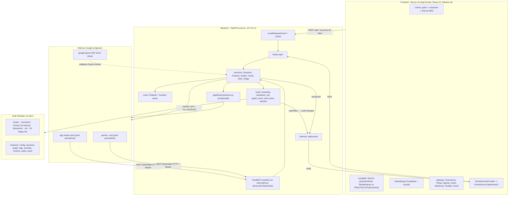
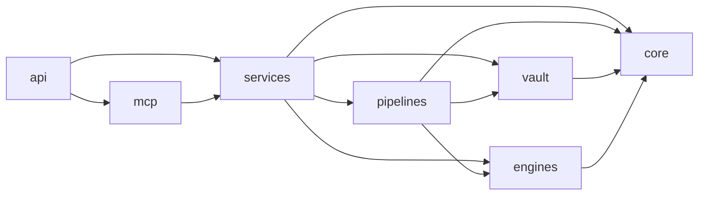
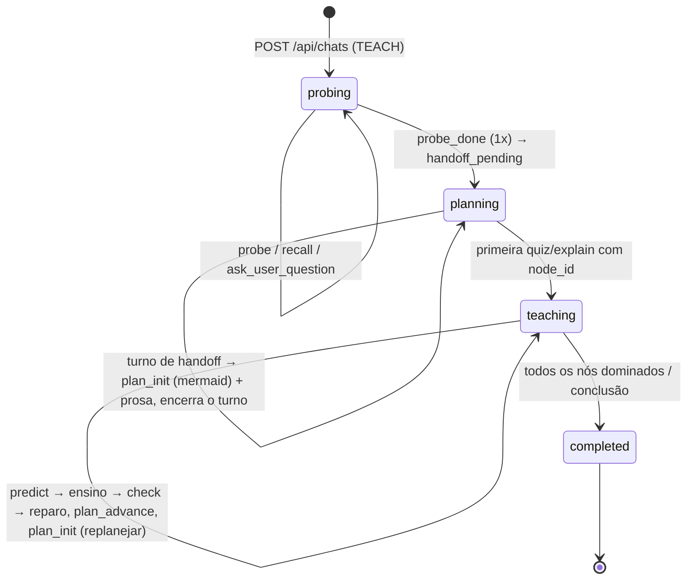
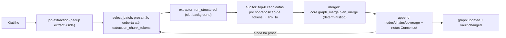

# Lapidare — Arquitetura Técnica (`ARCHITECTURE.md`)

Este documento descreve a arquitetura **atual** do Lapidare: camadas do backend, modelo de processo, protocolos (`stream-json`, `ACP`, `FastMCP`, `SSE`), motores Google, núcleo pedagógico, rastro de conhecimento, jobs em background, layout do Vault e frontend. Ele foi conferido contra o código em `backend/src/learnharness/**` e `frontend/**` e contra os specs de fase em [`docs/specs/`](specs/).

> [!NOTE]
> **Nome.** O produto se chama **Lapidare** (antes *LearnHarness*). Os identificadores técnicos mantêm o nome antigo por compatibilidade: o pacote Python `learnharness`, as variáveis `LEARNHARNESS_*`, a pasta `.harness/` do Vault, o servidor MCP interno `harness`, as chaves `learnharness:*` do `localStorage` e `~/.config/learnharness/`.
>
> **Estado.** Fases 8 a 23 implementadas (a Fase 15, nivelamento de trilha, está na seção [10.4](#104-fase-15--nivelamento-por-busca-binária); a Fase 23 é o fechamento das fases 19 a 22, ver [seção 16](#16-histórico-de-fases)).

Leia também: [`AGENTS.md`](../AGENTS.md) (invariantes) e [`CONTEXT_AND_BEHAVIOR.md`](CONTEXT_AND_BEHAVIOR.md) (comportamento esperado de cada tela).

## Sumário

1. [Produto em uma página](#1-produto-em-uma-página)
2. [Visão geral](#2-visão-geral)
3. [Layout hexagonal do repositório](#3-layout-hexagonal-do-repositório)
4. [Modelo de processo](#4-modelo-de-processo)
5. [Motores (conectores Google)](#5-motores-conectores-google)
6. [Núcleo pedagógico (TEACH)](#6-núcleo-pedagógico-teach)
7. [Sessões PRACTICE](#7-sessões-practice)
8. [Rastro de conhecimento (grafo)](#8-rastro-de-conhecimento-grafo)
9. [Jobs em background com steer](#9-jobs-em-background-com-steer)
10. [Trilhas](#10-trilhas)
11. [Vault: layout, invariantes e configuração](#11-vault-layout-invariantes-e-configuração)
12. [Import multi-fonte](#12-import-multi-fonte)
13. [Frontend](#13-frontend)
14. [Referência de rotas HTTP](#14-referência-de-rotas-http)
15. [Rodando e portões de qualidade](#15-rodando-e-portões-de-qualidade)
16. [Histórico de fases](#16-histórico-de-fases)

---

## 1. Produto em uma página

### 1.1 Apenas dois modos: `TEACH` e `PRACTICE`

`SessionMode = Literal["TEACH", "PRACTICE"]` (`core/contracts/session.py`). Não existe terceiro modo. O que varia dentro do `TEACH` é o **contexto** (`TeachContextKind`):

| `context_kind` | Quando | Prompt extra |
|---|---|---|
| `free_topic` | O aluno digita um tema no composer | — |
| `dense_source` | Sessão sobre uma fonte em `Fontes/` (MCP, GitHub, arquivo local) | `teacher/60-context-dense_source.md` (Dito / Pressuposto / Pulado / Simplificações, citações `[[Fonte#^pN]]`) |
| `track_step` | Um passo de trilha (`track_item_id`) | `teacher/70-context-track_step.md` (roteiro `2:1`) |
| `drawing_review` | Revisão de desenho Excalidraw (`/draw/[slug]`) | `teacher/80-context-drawing_review.md` |

O `PRACTICE` é uma sessão de um problema por vez com escada de dicas `R0–R5` (seção 7). A Fase 15 acrescenta o contexto `leveling`, também dentro do `TEACH`.

### 1.2 Home híbrida: grafo primeiro, trilhas opcionais

- **O grafo é a base de todo mundo.** A Home (`app/page.tsx`) mostra o grafo em tela cheia (`components/graph-view.tsx` + `graph-canvas.ts`). Qualquer sessão `TEACH` o alimenta enquanto acontece (seção 8).
- Por cima do grafo ficam a busca de nós, `☍ Chains`, `↑ Import`, `⇶ Roteiro` (só com trilha), a engrenagem de exibição e física e a pílula de uso (`usage-pill.tsx`).
- Embaixo fica o dock do composer (`composer.tsx`): `TEACH | PRACTICE`, a área de texto, a barra **Ditar**, o seletor de modelo e esforço (`model-picker.tsx`) e, só quando há trilha, o chip da trilha em foco (`track-chip.tsx`).
- Ao selecionar nós (Shift/⌘+clique) aparecem as ações **Ensinar a partir daqui** e **Praticar estes**. A nova sessão recebe `graph_context` (até 64 ids).

### 1.3 Várias trilhas, uma em foco

Uma trilha é uma fila ordenada de passos (`TrackConfig.queue: list[TrackItem]`). O config guarda **várias trilhas** (`tracks`) e **uma em foco** (`active_track_id`). A trilha se configura no Setup ou em **Configurações → Trilhas**. Na Home ela aparece só como o chip `⇶ <trilha> · Próximo: <item> [Continuar ↵] ▾`, cujo menu troca a trilha em foco. Veja a seção 10.

### 1.4 Design system ("The Skin")

Os tokens moram em `frontend/app/globals.css` (fonte única). `lib/palette.ts` os espelha para Canvas e Excalidraw, e `tests/tokens.test.cjs` proíbe hex literal fora desses lugares. A paleta atual é **roxa escura** (commit `149ba9d`), substituindo o grafite original:

| Token | Valor | Uso |
|---|---|---|
| `--background` | `#1a1430` | Fundo principal |
| `--card` | `#231b3e` | Cards e docks |
| `--accent` | `#30255a` | Hover e seleção |
| `--border` | `#54458a` | Bordas de 1px |
| `--foreground` | `#efeaff` | Texto |
| `--muted-foreground` | `#a99cd0` | Rótulos e metadados |
| `--success` / `--warning` / `--danger` | `#34d399` / `#e0a030` / `#f87171` | Estados |

- **Fontes** (embarcadas em `public/fonts/`): `--font-title` CMU Serif (`cmunbx.ttf`, `cmunrm.ttf`), `--font-prose` Source Sans 3 (16px / 1.5, ajustável de 14 a 20px em **Aparência** via `--prose-size`) e `--font-ui` JetBrains Mono. Os pesos reais estão embarcados (Fase 22): Source Sans 3 400/600/700 e JetBrains Mono 400/700, mais o CMU Bold 700, cada um com `@font-face` próprio em `globals.css` e a licença OFL ao lado (sem negrito sintético).
- **Foco:** `*:focus, *:focus-visible { outline: none }`.
- **Tema:** só escuro.

---

## 2. Visão geral



---

## 3. Layout hexagonal do repositório

```text
learnharness/
├── AGENTS.md · README.md · Makefile · scripts/dev.sh
├── docs/
│   ├── ARCHITECTURE.md · CONTEXT_AND_BEHAVIOR.md · assets/
│   └── specs/fase-*.md               # contratos de cada fase (seção 16)
├── backend/                          # Python ≥ 3.12, gerenciado por uv
│   ├── pyproject.toml                # fastapi, fastmcp, langgraph(+checkpoint-sqlite), google-genai, mcp, pypdf, watchfiles…
│   ├── src/learnharness/
│   │   ├── core/                     # PURO: zero I/O, rede, subprocesso ou langgraph
│   │   │   ├── contracts/            # config, session, quiz, graph, practice, jobs, drawing, demo
│   │   │   ├── calibration.py        # matriz acerto × confiança, resposta compacta, mastery
│   │   │   ├── plan_mermaid.py       # parser/validador do plano mermaid, status derivados
│   │   │   ├── graph_merge.py        # fold de nodes/chains, cobertura, plano de merge
│   │   │   ├── note_sources.py       # Fase 16: source_id, fold de sources, fatias de nota, citações
│   │   │   ├── practice.py           # graph_search, resolve_targets, fila de reteste
│   │   │   ├── compaction.py         # quando compactar, cauda literal, render do resumo
│   │   │   ├── session_export.py     # exportação Markdown da sessão
│   │   │   ├── svg_validation.py · demo_validation.py · latex_heal.py · text_hygiene.py
│   │   │   ├── lesson_layout.py      # layout gerenciado da nota de aula (render puro)
│   │   │   ├── slug.py               # ascii_slug: regra congelada de ids legados
│   │   │   ├── frontmatter.py        # regra única (Obsidian) de frontmatter: CRLF, BOM, `---` em valores
│   │   │   ├── turn_prompt.py        # o que um turno envia ao motor (one-shot | persistente)
│   │   │   ├── events.py             # SseEventType + SseFrame
│   │   │   └── ports.py              # Protocols: AgentEnginePort, ContentMcpPort
│   │   ├── engines/                  # adaptadores dos 3 caminhos Google
│   │   │   ├── agy_engine.py · agy_gate.py
│   │   │   ├── gemini_acp.py · gemini_engine.py
│   │   │   ├── genai_sdk_engine.py
│   │   │   ├── cli_protocol.py       # EngineError, idle_wait, json_events, drain_stderr, terminate_group
│   │   │   ├── detector.py · models.py · usage.py
│   │   ├── mcp/
│   │   │   ├── runtime_server.py     # guardas de modo, ordem publicada e servidor FastMCP
│   │   │   ├── tools/                # ferramentas por família: questions · lesson · practice · jobs (+ inputs)
│   │   │   ├── pending_dock.py       # asyncio.Future por pergunta pendente
│   │   │   ├── content_client.py     # cliente de QUALQUER servidor MCP de conteúdo
│   │   │   └── demo_builder.py       # geração/validação de simuladores HTML
│   │   ├── services/                 # casos de uso com estado (orquestram core + vault + engines)
│   │   │   ├── sessions.py · practice.py · graph.py · tracks.py · jobs.py · usage.py
│   │   │   ├── compaction.py · research.py · pdf_reader.py · visuals.py · demos.py
│   │   │   ├── graph_notes.py        # Fase 16: fontes de notas, job notes_import, remoção
│   │   │   └── agy_permissions.py · secrets.py
│   │   ├── vault/                    # todo acesso a disco do Vault
│   │   │   ├── bootstrap.py · safety.py · markdown_ast.py
│   │   │   ├── graph_store.py · jsonl_store.py · jsonl_io.py · transcript_importer.py
│   │   │   ├── github_source.py · excalidraw.py · watcher.py
│   │   ├── pipelines/extraction.py   # StateGraph Extractor → Auditor → Merger
│   │   ├── prompts/                  # fragmentos NN-*.md + loader.py (seção 6.4)
│   │   └── api/                      # app.py, state.py, sse.py, routes/*.py
│   └── tests/{unit,integration,fixtures/{acp,agy}}
└── frontend/
    ├── next.config.ts                # rewrite /api/* → BACKEND_URL (proxyTimeout 300 s)
    ├── app/                          # layout.tsx, page.tsx, chat/[id], draw/[slug], settings
    ├── components/                   # UI (seção 13)
    ├── lib/                          # módulos puros + clientes HTTP
    └── tests/*.test.cjs              # node --test sobre lib/ compilado
```

### 3.1 Regras de dependência



- `core/` não importa nada de fora de `core/` (só stdlib pura e Pydantic). Funções como `plan_merge`, `derive_plan_statuses`, `retest_queue`, `choose_first_kept` e `validate_svg` são testadas isoladamente.
- `AppState` (`api/state.py`) é a raiz de composição: ele instancia `SessionService`, `UsageService`, `JobManager`, `TrackService`, `GraphService` e `PracticeService`, o `SseHub`, o `PendingDockRegistry` e o `ContentMcpClient`, e fabrica motores com `engine(slot)`. Em testes, `engine_factory` injeta um `FakeEngine`.
- `core/ports.py` documenta as interfaces (`AgentEnginePort`, `ContentMcpPort`). Os serviços usam as funções de `vault/*` diretamente (o antigo `VaultPort` foi removido na Fase 19).

---

## 4. Modelo de processo

### 4.1 Um processo, uma app

`api/app.py:create_app()` monta um único FastAPI:

1. `create_runtime_mcp(state).http_app(path="/", stateless_http=True)` cria o app MCP. O `lifespan` do FastAPI roda **dentro** do lifespan do MCP (o gerenciador de sessões streamable-HTTP só vive ali) e chama `state.start()` / `state.close()`.
2. Middlewares, do mais externo ao mais interno: `LocalRequestGuard` e depois `CORSMiddleware`.
3. Handlers de erro: `SessionConflict → 409`, `EngineError → 502` (mensagem redigida por `AppState.redact`), `PermissionError → 403`, `FileNotFoundError → 404` (inclui `SessionNotFound`) e `ValueError → 422`.
4. Routers: `sse`, `setup`, `tracks`, `graph`, `chats`, `import_content`, `import_github`, `drawings`, `jobs`, `prompts`, `settings_agent` e `usage`.
5. `app.mount("/internal/mcp", ExecutionTokenGate(mcp_app, state))`.

`AppState.start()` (só com Vault configurado) recupera os jobs (`jobs.recover()`, que marca `running`/`queued` órfãos como `interrupted`), recupera as sessões e sobe o `VaultWatcher`. `close()` encerra sessões, jobs, os pools de processos CLI (`close_engine_processes`) e o watcher, e limpa os tokens.

**Seleção do Vault** (`selected_vault_path`), nesta ordem: `LEARNHARNESS_VAULT_PATH`, depois o registro `$XDG_CONFIG_HOME/learnharness/active-vault` (gravado pelo Setup) e por fim `~/Documents/StudyVault`.

### 4.2 MCP interno em `/internal/mcp` e tokens Bearer por sessão

- O servidor `FastMCP("learnharness")` expõe as mesmas funções que `session_tools(state, session_id)` constrói. Cada ferramenta registrada é um *proxy* que resolve a sessão pelo header `Authorization: Bearer …` (`state.bound_session(token)`) e despacha para a função ligada àquela sessão. **Nenhuma ferramenta age sobre estado global.**
- **Token:** `AppState.session_token(session_id, execution_id)` mantém **um token por sessão**, re-ligado à execução corrente a cada turno. Processos CLI persistentes guardam o token na configuração MCP, então trocá-lo a cada turno forçaria respawn. `bound_session` rejeita com `PermissionError` um token cujo `execution_id` ficou para trás ("Execution token is stale"). Os tokens são revogados ao fechar a sessão ou a app.
- **`ExecutionTokenGate`:** qualquer requisição a `/internal/mcp` sem token vivo recebe `401`; sem token, nem listar ferramentas é possível.
- **URL anunciada** aos motores: `LEARNHARNESS_MCP_URL` ou `http://127.0.0.1:${LEARNHARNESS_PORT:-8000}/internal/mcp/`.
- **Guarda de modo** (`_mode_guard`): ferramentas `TEACH_ONLY` são recusadas em `PRACTICE` e `PRACTICE_ONLY` (`problem`, `conclude`) são recusadas em `TEACH`, sempre com texto corretivo. `_refusals` converte `SessionConflict`/`PlanSyntaxError` em `ToolError` legível, para o modelo corrigir e tentar de novo no mesmo turno.
- **Entradas tolerantes:** opções como string ou objeto (`label`/`text`/`content`), listas serializadas como string JSON, `correct` por `value` ou `label`, LaTeX escapado duas vezes (`core/latex_heal.py`).

### 4.3 Proteção da API local

A API escreve no disco e pode registrar servidores MCP `stdio`, ou seja, executar comandos locais. Por isso:

- **`LocalRequestGuard`:** o `Host` precisa estar em `LEARNHARNESS_ALLOWED_HOSTS` (padrão `localhost,127.0.0.1,::1,testserver`); se não estiver, a resposta é `421`, o que bloqueia DNS rebinding. Um método não seguro com `Origin` fora de `LEARNHARNESS_CORS_ORIGINS` recebe `403`.
- **CORS:** `LEARNHARNESS_CORS_ORIGINS` (padrão `http://localhost:3000,http://127.0.0.1:3000`), sem credenciais. O navegador normalmente fala pelo proxy do Next, então o CORS só importa para acesso direto.
- **Redação:** erros de motor e de job passam por `AppState.redact`, que remove a chave de API, `GEMINI_API_KEY` e os tokens MCP vivos, e corta em 2000 caracteres.

### 4.4 Canal SSE único (notify → fetch)

`GET /api/events` (`api/sse.py`) entrega frames `event: <tipo>\ndata: <json>` de um `SseHub` (uma `asyncio.Queue` por assinante), com `: heartbeat` a cada 15 s. O frame só **avisa**; a UI então **busca** o recurso pela rota REST. No frontend, `components/server-events.tsx` abre **um único** `new EventSource("/api/events")` por janela, reconecta sozinho e distribui os frames por `subscribe(tipos, cb)`. Não há `setInterval` de polling.

Eventos (`core/events.py: SseEventType`, espelhado em `frontend/lib/types.ts`):

| Evento | Emitido quando | A UI busca |
|---|---|---|
| `session:updated` | Mensagem, fase, status, renomear, excluir (`deleted: true`), restaurar da lixeira (`restored: true`), excluir da lixeira (`purged: true`) | `GET /api/chats/{id}`, `GET /api/chats`, `GET /api/chats/trash` |
| `dock:opened` | Uma ferramenta de pergunta abriu o `QuestionDock` | `GET /api/chats/{id}` |
| `dock:resolved` | Resposta ou dispensa de pergunta | `GET /api/chats/{id}` |
| `plan:updated` | `plan_init` / `plan_advance` / status derivado | `GET /api/chats/{id}` |
| `vault:changed` | Watcher do Vault, notas de conceito, nota de trilha | Painéis de nota, grafo |
| `graph:updated` | Lote de extração aplicado, nó excluído, sessão renomeada/excluída/restaurada, watcher (exceto `.harness/prompts/`) | `GET /api/graph` |
| `jobs:updated` | Qualquer gravação em `jobs.jsonl` | `GET /api/jobs` |
| `usage:updated` | Nova linha em `usage.jsonl` | `GET /api/usage` |
| `config:updated` | Trilhas, ajustes do agente, setup | `GET /api/tracks`, `GET /api/setup/status`, `GET /api/settings/agent` |

### 4.5 `JobManager` (fila de jobs em background)

`services/jobs.py`:

- **Persistência:** fila *append-only* em `.harness/jobs.jsonl`. Cada `save()` grava o registro inteiro e emite `jobs:updated`; a leitura fica com o último estado de cada `job_id`.
- **Concorrência:** `asyncio.Semaphore(2)`. Estados: `queued → running → completed | failed | interrupted`. `POST /api/jobs/{id}/retry` reabre jobs `failed`/`interrupted`. `POST /api/jobs/{id}/cancel` cancela um job `queued`/`running` (`JobManager.cancel`): grava `interrupted` com `error = "cancelado pelo usuário"` e entrega um steer de falha uma única vez; o desligamento do servidor continua sem steer; job já terminado devolve `409` e id desconhecido, `404`. O cancelado pode ser retentado.
- **Deduplicação** por `dedup_key`: `extract:<session_id>` (só enquanto `queued`) e `track:<track_id>`.
- **Uso:** cada job instala uma captura de uso com `job_kind` (seção 5.6).

| `kind` | Origem | Corpo |
|---|---|---|
| `extraction` | Gatilho do fim de turno, conclusão, `POST /api/graph/extract/{id}`, `POST /api/jobs/extract` | `GraphService.extract_session` (seção 8) |
| `track_gen` | `POST /api/tracks` (`goal`/`repo`/`github`), `/regenerate`, Setup, import do GitHub | `TrackService.generate(track_id)` |
| `demo_builder` | Ferramenta `spawn_demo`, `POST /api/demos` | `services/demos.run_demo_job` → `viz/demos/<slug>.html` |
| `research` | Ferramenta `research` | `services/research.run_research_job` → laço multi-etapas em `services/research_agent.py` (seção 9) |
| `pdf` | Ferramenta `read_pdf` | `services/pdf_reader.run_pdf_job` → `services/pdf_agent.py` (texto + visão, seção 9) |
| `visual` | Ferramenta `visual` | `services/visuals.run_visual_job` → `viz/visuals/<slug>.svg` |
| `notes_import` | `POST /api/graph/import`, `POST /api/graph/import-vault` (Fase 16) | `services/graph_notes.run_import_job`: até 3 arquivos em paralelo, `record.files[]` com status por arquivo (seção 8.4) |

Os jobs despachados de uma sessão (`research`, `pdf`, `visual`, `demo_builder`) **voltam para ela como steer** (seção 9).

---

## 5. Motores (conectores Google)

### 5.1 Contrato comum

`AgentEnginePort` (`core/ports.py`) define `stream_turn(prompt, session_id, history, slot, tools, system_instruction)`, que faz streaming de texto, e `run_structured(prompt, schema, slot, system_instruction)`, que devolve JSON validado por Pydantic. `engines.get_engine(slot)` escolhe o motor **explicitamente** pelo `slot.engine` (`EngineKind`: `agy`, `gemini_cli`, `genai_sdk`), sem troca silenciosa de provedor quando um falha.

Atributos que o runner de sessão consulta:

| Atributo | `agy` | `gemini --acp` | `google-genai` |
|---|---|---|---|
| `tool_transport` | `mcp` | `mcp` | `inline` |
| `session_persistent` | `True` | `True` | — |
| `configure_runtime(work_dir, mcp_url, token)` | grava `.agents/` no work dir | guarda URL/token para `session/new` | — |
| `research(prompt, slot)` | gate `research` | `google_web_search` | `google_search` grounding |
| `review_image(png, instructions, schema, slot, *, context, system_instruction, image_name, subject)` | gate `vision` (`read_file` do PNG) | `@<png>` no headless | `Part.from_bytes` |

- **`tool_transport="mcp"`:** o motor descobre as ferramentas no MCP interno.
- **`"inline"`:** o runner passa os callables Python de `state.tool_functions(session_id)` em `stream_turn(tools=…)`.

**Timeout de inatividade** (`cli_protocol.idle_wait`): os motores CLI não têm teto de tempo total. O que existe é um relógio de **segundos sem nenhum evento do provedor** (padrão 180 s, `GeminiHeadlessEngine.timeout`). O relógio fica **suspenso** enquanto:

- uma ferramenta do harness está em voo (por exemplo, uma pergunta bloqueada esperando o aluno), ou
- há uma pergunta pendente na sessão: `AppState.engine()` passa `is_waiting_on_learner = dock_registry.get_pending_quiz(sid) is not None`.

### 5.2 `AgyStreamEngine` (recomendado)

`engines/agy_engine.py`, verificado contra agy 1.4.7/1.4.8 (fixtures em `tests/fixtures/agy/`):

- **Processo persistente e multi-turno:** `agy --input-format stream-json --output-format stream-json --disable-slash-commands [--model <id>] [--effort <nível>]`. Cada turno é uma linha NDJSON `{"event":"user","message":{"content":…}}` no stdin. Os eventos de saída são `init`, `step_update` (`agent_response` com `text_delta`, `tool`, `finish`) e um `result` por turno.
- **Pool:** `AGY_POOL` (um `AcpProcessPool`) guarda um processo por sessão do harness. A chave do processo é `(comando, work_dir, mcp_url, token)`: mudar o modelo, o esforço ou as credenciais fecha o processo, e o próximo turno **reidrata** a partir do histórico persistido (`compose_prompt(…, fresh=True)`). Entradas ociosas fecham após `IDLE_CLOSE_SECONDS = 600`; `hold/release` impede o fechamento durante o turno.
- **Morte precoce:** se o agy sai durante o turno **antes** de emitir texto ou chamar uma ferramenta do harness (`AgyDiedEarly`), há **um** respawn transparente, porque nada foi observado e não há efeito colateral duplicado. Depois de progresso, a falha vira `EngineError`. Em qualquer fim não limpo (timeout, crash, cancelamento), o processo é fechado e o próximo turno reidrata.
- **Esforço:** ids de `agy models` que já fixam o esforço (`…-low`, `…-high`, `model_pins_effort`) não recebem `--effort`, porque o agy o rejeitaria.
- **Workspace** (`write_agy_workspace`, em `.harness/runtime/<session_id>/.agents/`): `mcp_config.json` (URL + header Bearer, `0600`), `hooks.json` (hook `PreToolUse`), `harness_gate.py` (cópia de `agy_gate.py`, executada com `python -I`) e `gate_policy.json`.
- **Gate** (`agy_gate.decide`):
  - política `harness`: permite só `call_mcp_tool` com `ServerName == "harness"`, o terminador `finish` (saída estruturada) e a leitura dos schemas MCP em cache; nega o resto (shell, arquivos, navegador, outros MCPs globais do usuário);
  - política `research`: permite só `search_web`, `read_url_content` e `finish`, num workspace temporário **sem** servidor MCP.
  - política `vision`: permite só `read_file`/`view_file` dentro do workspace descartável, mais `finish`. Usada por `review_image` (genérico: veredito estruturado sobre um PNG), que serve a revisão de desenhos (`review_drawing_multimodal`) e a conferência dos visuais (§9): o PNG é gravado no workspace e o agy o lê como imagem. A chamada falha com erro claro se o agy nunca abrir a imagem.
- **Permissão global `mcp(harness/*)`** (`services/agy_permissions.py`): o agy headless recusa sem aviso chamadas MCP que pediriam confirmação, e só lê regras do arquivo **global** `~/.gemini/antigravity-cli/settings.json`. O harness acrescenta essa única regra estreita, **só com consentimento explícito** (`POST /api/setup/agy-permission`), com backup datado e escrita atômica. Sem ela, um turno com slot forte agy falha com uma instrução clara ("Conceda em Configurações → Conectores"). Status: `GET /api/setup/agy-permission`.
- **Chamadas avulsas:** `run_structured` usa `--json-schema` num workspace temporário, nunca no cwd do backend. `research` exige que `search_web`/`read_url_content` tenham de fato rodado. Com `--json-schema`, o agy às vezes escreve o JSON completo no texto e chama `finish` com um resumo; `pick_structured` (`engines/gemini_engine.py`) prefere o bloco JSON do texto quando ele valida e é mais completo.

### 5.3 `GeminiCliAcpEngine` (`gemini --acp`)

`engines/gemini_acp.py` fala Agent Client Protocol (JSON-RPC 2.0 sobre stdio), verificado contra gemini-cli 0.62.0 (`tests/fixtures/acp/`):

- Comando: `gemini --acp --allowed-mcp-server-names harness`. Um processo persistente por sessão vive em `ACP_POOL` (mesmo `AcpProcessPool`, 10 min ocioso).
- O MCP interno vai em `session/new` / `session/load` (`mcpServers: [{type: "http", url, headers}]`), então **o token nunca é gravado em disco**. Pedidos `session/request_permission` são aprovados (`allow_once`) só para chamadas do servidor `harness` (`harness_tool_call`); os demais são rejeitados, e os métodos `fs/*` e `terminal/*` respondem "method not found".
- **Ressalva de conta:** desde o gemini-cli 0.62, contas pessoais do *Gemini Code Assist* são bloqueadas pelo próprio CLI com a orientação de migrar para o Antigravity. Por isso o **agy é o conector recomendado** para a assinatura pessoal. O `gemini --acp` continua para Workspace / Code Assist Standard e chave de API.
- **Pesquisa:** `GeminiHeadlessEngine.research` roda `gemini` headless (`stream-json`) num workspace temporário cujo `settings.json` libera só `google_web_search`, e falha se a busca não rodou com sucesso.

### 5.4 `GenAiSdkEngine` (`google-genai`)

`engines/genai_sdk_engine.py`: SDK oficial (`GEMINI_API_KEY`, chave informada no Setup ou Vertex AI), com `tool_transport = "inline"` e `response_schema` para saídas estruturadas. A pesquisa usa `types.Tool(google_search=types.GoogleSearch())` (grounding), com as fontes tiradas do `grounding_metadata`.

### 5.5 Slots, catálogo de modelos e override por sessão

- `HarnessConfig.slots` tem três `ModelSlotConfig {engine, model_id, effort}`:
  - **`strong`:** turnos de ensino e prática;
  - **`fast`;**
  - **`background`:** extração, auditoria, compactação e jobs.
  - `EffortLevel`: `low | medium | high`.
- **Catálogo:** `GET /api/setup/models?engine=…` (`engines/models.py`) lê `agy models` (cache de 600 s) ou o SDK. Para o gemini CLI, usa uma lista fixa documentada. `POST /api/setup/connectors/test` faz um teste real, com latência.
- **Override por sessão:**
  - `POST /api/chats` aceita `model_id` e `effort`; `PUT /api/chats/{id}/settings` muda os dois depois;
  - o valor fica em `SessionRecord.slot_override`, e `session.teaching_slot(config.slots.strong)` resolve o slot efetivo (devolvido como `effective_slot`);
  - mudar o modelo fecha o processo persistente.
- **Seletor no frontend:** `components/model-picker.tsx` + `lib/model-choice.ts`. Ele abre num portal com posição fixa (`lib/popover-position.ts`), agrupa por família com chips de esforço, tem navegação por teclado e vira *sheet* no mobile. Abre por `⌘K` (`OPEN_MODEL_PICKER_EVENT`).

### 5.6 Contabilidade de uso

- **Sink ambiente** (`engines/usage.py`): um `ContextVar` (`learnharness_usage_sink`). Cada motor chama `report_usage(model_id, counts)` ao ler o evento terminal do provedor, sem mudar a assinatura do `AgentEnginePort`:
  - agy: `result.usage`;
  - ACP: `_meta.quota.token_count`;
  - gemini headless: `result.stats`;
  - SDK: `usage_metadata`.
- **Captura** (`services/usage.py: UsageCapture`): `SessionService.run` e `JobManager.run` instalam uma captura por turno ou job. Por ser um `ContextVar`, sessões e jobs concorrentes nunca se misturam. Cada relatório vira uma linha em `.harness/usage.jsonl` (`{at, session_id, job_kind, model_id, input_tokens, output_tokens, thinking_tokens, turn, cached_tokens}`; `turn` (= `SessionRecord.turn_seq`, incrementado a cada execução) e `cached_tokens` são opcionais, e linhas antigas sem eles continuam legíveis) e emite `usage:updated`. Ao fim do turno, o total acumula em `SessionRecord.usage` (`SessionUsage`, com `turns`). Desde a Fase 23, o job grava também o `session_id` do payload (quando houver) com `charge=False`: a linha aparece no uso por turno da sessão, mas não soma no total dela.
- **Medidor de contexto (Fase 21):** `SessionUsage` ganha `context_tokens` (entrada + saída do **último** relatório; volta a `None` após uma compactação) e `last_turn` (soma dos relatórios do último turno, com `cached_tokens` quando o provedor informa). `core/model_limits.py` (puro) tem `context_window(model_id)` (tabela por prefixo de família Gemini; `None` se desconhecida) e `context_limit(compaction_tokens, window)`, que devolve `(limite, "compaction" | "window")`: vence a janela menos a reserva de 16 000 tokens quando ela vem antes do limiar de compactação. `GET /api/chats/{id}` inclui em `usage` `context_tokens`, `context_limit`, `limit_kind` e `last_turn`. Desde a Fase 23, o `context_tokens` da API é `history_tokens(messages, compaction)` (`core/compaction.py`), a mesma estimativa que a compactação compara com o orçamento; o valor gravado vindo do provedor não serve de medida, porque o `agy` soma no relatório do turno todas as chamadas internas (um turno de diagnóstico real mostrou 154k "de contexto" com ~1k de histórico).
- **Leitura:** `GET /api/usage` → `{today, total, by_session: top 10}`. A UI mostra a pílula na Home e o uso no cabeçalho da sessão (`lib/usage.ts`).
- **Uso por turno (Fase 23):** `GET /api/usage/sessions/{session_id}` (`UsageService.session_turns`; 404 para sessão inexistente) → `{session_id, turns: [{turn, input_tokens, output_tokens, thinking_tokens, cached_tokens?, calls, at}], background: [{job_kind, …tokens, calls}], untracked?}`: `turns` traz os últimos turnos de ensino (mais antigo primeiro), `background` soma as linhas de job por `job_kind` e `untracked` (só quando não zero) reúne linhas antigas sem `turn` nem `job_kind`.
- **Popover do chip** (`components/session-usage-chip.tsx`): barra de contexto ("42k / 150k até compactar" ou "até o limite do modelo"; "?" quando o servidor não manda `context_tokens`), último turno, total da sessão e a seção **Turnos** (mini-barras dos últimos 10 turnos + totais de segundo plano por `job_kind`), tudo formatado por funções puras de `lib/usage.ts`.

---

## 6. Núcleo pedagógico (TEACH)

### 6.1 Máquina de fases



- `SessionPhase`: `probing → planning → teaching → completed`. `awaiting_answer`/`consolidating` só existem em registros anteriores à Fase 8 e são normalizados na leitura (`LEGACY_PHASES`).
- "Esperando o aluno" é o `execution_status="waiting"`. `ExecutionStatus`: `idle | queued | running | compacting | waiting | interrupted | failed | completed`.
- PRACTICE fica sempre em `phase="teaching"` (sem diagnóstico nem plano).

### 6.2 Ferramentas MCP

Definidas em `mcp/runtime_server.py: session_tools`. As de pergunta **bloqueiam até a resposta** e devolvem a resposta compacta.

| Ferramenta | Modo | Fase / condição | Efeito |
|---|---|---|---|
| `probe` | TEACH | `probing` | Múltipla escolha graduada (`mode=PROBE`), com confiança |
| `recall` | TEACH | `probing` | Resposta aberta com `committed_answer` imutável (`kind=explain, mode=PROBE`) |
| `quiz` | TEACH | plano existente + `node_id` válido | `type: predict\|check` → `PREDICTION`/`CHECK`; `explanation` vem antes de `correct` |
| `explain` | TEACH | idem | Versão aberta do `quiz`, avaliada por `grade_recall` |
| `ask_user_question` | ambos | qualquer | Pergunta sem nota (`kind=ask`) com opções, `description` e "Outro…" |
| `probe_done` | TEACH | `probing`, uma vez, sem pergunta pendente | Grava `ProbeAssessment {strands[], summary}`, passa a `planning` e arma o handoff |
| `plan_init` | TEACH | após `probe_done` | Mermaid → `PlanDag`; ids permanentes; preserva `mastered`/`needs_review` |
| `grade_recall` | TEACH | qualquer | `verdict: correct\|partial\|incorrect` + `feedback` de um `recall`/`explain` |
| `plan_advance` | TEACH | `teaching` | `mastered \| needs_review` (com gate de mastery) |
| `track_foundation` | TEACH | sessão com trilha | Insere um pré-requisito na trilha da sessão quando o diagnóstico revela lacuna |
| `spawn_demo` · `visual` | TEACH | toggle `demo`/`visual` | Despacha um job (seção 9) |
| `research` · `read_pdf` | ambos | toggle `research`/`pdf` | Despacha um job (seção 9) |
| `problem` · `conclude` | PRACTICE | seção 7 | — |
| `graph_search` | ambos | somente leitura | `[{id, name, statement, session_title}]` por sobreposição de tokens |

- **Plano** (`core/plan_mermaid.py`): aceita `graph|flowchart TD|LR|BT|RL`, `id[Título]`, `id("Título")`, arestas `-->`, `==>`, `-.->`, cadeias `a-->b-->c` e comentários `%%`. Os ids são slugs. Erros vêm com número da linha. A validação rejeita ids duplicados, extremidades desconhecidas, laços, arestas repetidas e ciclos.
- **`kind` derivado:** `unconditional_truth`, `derived_step` ou `goal`.
- **Status derivado:** `current` é o nó da última pergunta com `node_id`; `visited` são os anteriores; `pending` é o resto. `mastered`/`needs_review` persistem por `plan_advance`.
- **Mastery:** um `CHECK quiz` correto e calibrado, ou um `CHECK explain` com `grade="correct"` (`core/calibration.is_mastery_evidence`).

### 6.3 Pergunta bloqueante e calibração

1. A ferramenta chama `SessionService.pose`. Ele valida a fase e o `node_id` (`_guard_question`), grava `pending_quiz` no JSONL da sessão (assim um reload recupera o cartão), emite `dock:opened` e aguarda o `asyncio.Future` de `PendingDockRegistry`.
2. `POST /api/chats/{id}/answer` (`QuizSubmission`: `chosen_indices`, `is_dont_know`, `confidence` 0–100, `learner_thinking`, `reading_thinking`, `text`, `other_text`) passa por `evaluate_calibration`, grava em `.harness/quiz-log.jsonl` (exceto `ask` e dispensadas), resolve o Future e emite `dock:resolved`.
3. O modelo recebe a **resposta compacta** (`compact_answer`): só o que o aluno acrescentou (`answers`, `correct`, `confidence`, `calibration_band`, `directive`, `thinking`, `thinking_while_reading`). Para `recall`/`explain`, vêm também o `committed_answer` e a instrução de avaliar com `grade_recall`.
4. **O gabarito não vaza:** enquanto pendente, `GET /api/chats/{id}` serializa a pergunta sem `correct_indices`, `committed_answer` e `explanation` (`_serialize_quiz`).
5. **Escala de confiança:** slider livre de 0 a 100 (passo 5 no teclado), padrão 50, com rótulos "Pouca/Alguma/Muita certeza", só em `quiz`/`probe`; "Não sei" desliga a confiança e é tratado como lacuna, não como erro. Ao responder, o relógio de inatividade do motor volta a contar do zero.

### 6.4 Prompts: fragmentos numerados + overrides

`prompts/` contém fragmentos `NN-nome.md` (regex `^\d+-[\w.-]+\.md$`), compostos em ordem numérica e unidos por `\n\n---\n\n` (`prompts/loader.py`):

| Diretório | Fragmentos |
|---|---|
| `shared/` | `10-identity`, `20-voice`, `30-accuracy`, `40-mental-model`, `50-questions`, `60-confidence`, `70-formatting`, `80-vault` |
| `prober/` | `10-diagnosis`, `20-contexts` |
| `teacher/` | `10-method`, `20-planning`, `30-teaching`, `40-predict-and-check`, `50-demos`, `55-background-jobs`, `60-context-dense_source`, `70-context-track_step`, `80-context-drawing_review` |
| `practice/` | `10-opening`, `20-doctrine`, `30-hints`, `40-reading-attempts`, `50-conclude` |
| raiz | `handoff.md` (texto do turno de handoff) |

- **Seleção** (`build_system_prompt(mode, context_kind, language, phase, extra_context, overrides)`):
  - `probing` → `shared` + `prober`;
  - `planning`/`teaching` → `shared` + `teacher`;
  - PRACTICE → `shared` sem `50-questions.md` + `practice`.
  - Os fragmentos `NN-context-<kind>.md` só entram para o `context_kind` correspondente.
- Os prompts são escritos em inglês e mandam responder no idioma da sessão. As regras de turno (`TURN_RULES` / `PRACTICE_TURN_RULES` em `services/sessions.py`) vão junto em cada system prompt.
- **Overrides:** o texto fica em `<vault>/.harness/prompts/<path>` e só vale com `config.prompt_overrides[path] is True` e o arquivo existindo. As flags vivem só em `config.prompt_overrides`; `.harness/prompt-overrides.json` é legado, ainda **lido** (o config prevalece) mas nunca mais escrito. Rotas: `GET/PUT/DELETE /api/settings/prompts[/{path}]`, com o path validado contra os segmentos existentes.

### 6.5 O ciclo de um turno (`SessionService.run`)

```mermaid
sequenceDiagram
    autonumber
    participant UI
    participant API as FastAPI
    participant S as SessionService
    participant E as Motor (agy/ACP/SDK)
    participant M as MCP /internal/mcp
    UI->>API: POST /api/chats/{id}/messages
    API->>S: schedule(_drive)
    S->>S: execution_id novo, status=running, steers pendentes → delivered
    S->>S: system = fragmentos + contexto JSON + SOURCE + graph_context + material PRACTICE
    S->>E: stream_turn(prompt, history|persistente, slot)
    E-->>S: deltas de texto (session:updated a cada 0,2 s; gravação a cada 2 s)
    E->>M: quiz(...) com Bearer
    M->>S: pose() → pending_quiz, dock:opened, aguarda Future
    UI->>API: POST /answer
    API->>S: answer() → calibração, quiz-log, Future resolvido
    M-->>E: resposta compacta
    E-->>S: fim do turno (result)
    S->>S: status waiting|queued|idle · gatilho de extração · compactação
    S-->>S: follow-up? (handoff ou steers) → novo run()
```

- **Motores persistentes** (`_persistent_turn`): o processo guarda a conversa, então cada turno envia só o **conteúdo novo**: tudo depois de `SessionRecord.model_cursor`, o id da última mensagem que o processo já viu, gravado no fim de cada turno bem-sucedido. Respostas e steers entregues no meio do turno pelas ferramentas de pergunta ficam antes do cursor e nunca são reenviados; steers ainda não entregues entram mesmo se estiverem antes dele. Sem cursor, vale a regra antiga (depois da última mensagem do assistente). No turno de handoff, o conteúdo novo vai junto da instrução de planejamento mais `CURRENT STATE` (fase e status do plano, ou o problema ativo). O system prompt vai como `system_instruction` e só é usado ao (re)criar o processo, com o histórico compacto.
- **Troca de família de prompt:** quando `prompt_family` muda (`prober → teacher`), o turno abre com `UPDATED INSTRUCTIONS (they replace your previous system instructions)`. `SessionRecord.prompt_phase` registra a família enviada por último.
- **Motores não persistentes:** a cada turno vai `system + PERSISTED HISTORY + regras`, e o primeiro turno recebe `opening_request` (o título da sessão **é** o pedido do aluno).
- **Handoff:** `probe_done` arma `handoff_pending`. Quando o turno de diagnóstico termina, `_drive` roda logo em seguida um **turno de handoff** com `handoff.md` ("planeje o arco a partir do diagnóstico, chame `plan_init`, apresente e encerre"). É uma tentativa só; uma nova tentativa depende do aluno.
- **Steers:** `deliver_steer(session_id, kind, content, details)` grava uma mensagem `role="user"` com `steer_kind` `learner` (enviada durante o turno, por `POST /api/chats/{id}/steer`) ou `job` (resultado de job), com `delivered=False`. Se a sessão está ociosa, agenda um turno. Se está ocupada, o turno corrente termina e `_steers_due` dispara um **turno de follow-up**. Com uma pergunta pendente, o steer espera a resposta e **segue junto dela**: `SessionService._attach_steers` acrescenta ao retorno da ferramenta de pergunta bloqueante os campos `learner_messages` (steers `learner`) e `background_results` (steers `job`) e os marca como entregues. Assim, um professor que encadeia perguntas no mesmo turno não deixa mensagens do aluno nem resultados de jobs esperando até o fim do turno.
- **Escrita da prosa:** durante o streaming, a cada 0,2 s só é emitido `session:updated`; o `GET /api/chats/{id}` sobrepõe o texto em memória (`SessionService.live_view`). A gravação no JSONL (que é append-only e guarda o snapshot inteiro) acontece a cada 2 s, sem re-renderizar a nota. A leitura valida só o último snapshot e fica em cache até o arquivo crescer (`vault/jsonl_io.py`), e `GET /api/chats` devolve linhas leves, sem mensagens, plano nem respostas; a nota da aula é atualizada antes de ferramentas e no fim do turno. Antes de ferramentas que mudam o plano ou abrem um problema, o texto até ali é gravado e a mensagem é dividida (`split_streaming` / `flush_streaming`), para a prosa ficar na seção certa da nota.
- **Fim do turno:**
  - status `waiting` (pergunta pendente), `queued` (há follow-up) ou `idle`;
  - `_trigger_extraction` (seção 8);
  - `_compact_at_settle` (6.6);
  - nota da aula atualizada (`refresh_lesson_note`);
  - ao completar, o runtime é liberado (processo fechado, tokens revogados).

### 6.6 Compactação de contexto

- **Gatilho** (`core/compaction.py`): as mensagens que o modelo ainda lê literalmente passam de `config.agent.compaction_tokens` (padrão 150 000, mínimo 32 000; estimativa `chars/4`). Roda no fim do turno, com `execution_status="compacting"`, e o próximo turno espera.
- **Resumo** (`services/compaction.compact_session`): o slot `background` gera as seções obrigatórias: entendimento do aluno, arco do ensino, plano atual na íntegra e momento atual.
- **Armazenamento:** `SessionRecord.compaction = {summary, first_kept_message_id, tokens_before, at}`, com uma cauda literal de cerca de `TAIL_TOKENS = 20 000`. As mensagens antigas continuam no JSONL.
- **Uso no prompt:** `split_history` → `summary_block(summary)` + cauda, tanto na reidratação persistente quanto no `PERSISTED HISTORY`. Se a compactação falhar, ela é registrada no log e a sessão segue com o histórico completo.

### 6.7 Controles da sessão

| Ação | Rota | Comportamento |
|---|---|---|
| Steer | `POST /api/chats/{id}/steer` | Mensagem do aluno durante o turno (6.5) |
| Abortar | `POST /api/chats/{id}/abort` | Cancela a task (→ `interrupted`), dispensa a pergunta pendente e fecha o processo persistente |
| Dispensar pergunta | `POST /api/chats/{id}/questions/dismiss` | `dismissed: true`, sem nota nem `quiz-log`; o modelo recebe "não repita a pergunta" |
| Renomear | `PUT /api/chats/{id}` `{title}` (1–200) | A nota mantém o caminho; só os campos gerenciados mudam |
| Excluir | `DELETE /api/chats/{id}?mode=preserve-graph\|delete-nodes` | Acrescenta ao JSONL o evento `{"event":"trashed","deleted_at","mode","graph_unlinked"}` e o move para `.harness/trash/`; **nunca** apaga a nota em `Aulas/`; `delete-nodes` desfaz os vínculos no grafo (seção 8); `409` com turno rodando |
| Lixeira | `GET /api/chats/trash` | `[{id, file, title, mode, deleted_at, updated_at, message_count, graph_unlinked, delete_mode}]`, excluídas mais recentes primeiro. Arquivos antigos sem o evento `trashed` entram com `deleted_at` = ctime do arquivo (o `rename` o atualiza), `graph_unlinked=false` e `delete_mode=null` |
| Restaurar | `POST /api/chats/trash/{file}/restore` | Move o arquivo de volta para `.harness/sessions/<id>.jsonl` (o id vem do snapshot, não do nome com sufixo datado; `os.link` + `unlink`, nunca sobrescreve). `409` se já existe sessão viva com esse id. Uma sessão excluída no meio do turno volta normalizada como em `recover()` (`interrupted`, ou `waiting` com pergunta). Resposta `{session, graph_restored: false}`: os vínculos de grafo removidos por `delete-nodes` **não** voltam; a nota em `Aulas/` nunca saiu do lugar |
| Excluir definitivamente | `DELETE /api/chats/trash/{file}?confirm=true` | Apaga só aquele arquivo da lixeira; sem `confirm=true` → `422`. `{file}` é um basename `*.jsonl` resolvido por `safe_path` dentro de `.harness/trash/` (`..`, ocultos, outras extensões → `403`) |
| Exportar | `GET /api/chats/{id}/markdown` | `text/markdown` com `Content-Disposition` (`core/session_export.py`) |
| Retomar | `POST /api/chats/{id}/resume` `{restart_diagnostic}` | Reagenda a sessão; registros legados incompletos exigem reiniciar o diagnóstico |
| Modelo/esforço | `PUT /api/chats/{id}/settings` | Seção 5.5 |

Sessões inexistentes respondem `404` (`SessionNotFound`).

---

## 7. Sessões PRACTICE

- **Abertura:** pelo composer em modo PRACTICE, por **Praticar estes** (o `graph_context` vira o material) ou por um item de trilha. Sem aquecimento: o agente abre com o primeiro problema.
- **Ferramentas:**
  - `problem(statement, mode: recall|discrimination|composition, model_solution, target)` registra o problema ativo e **não bloqueia**. Ela recusa se já houver um ativo; `target` aceita ids `n_…` ou nomes exatos, resolvidos por `core/practice.resolve_targets`.
  - `conclude(outcome: solved|solvedWithHints|movedOn|surrendered, verdict, rung R0–R5|null, miss_class: cue|discrimination|execution|careless|structural|null, retest)` fecha o problema, revela a `model_solution` e grava uma linha em `.harness/practice-log.jsonl`.
- **Entradas do aluno:** `POST /api/chats/{id}/messages` com `kind`:
  - `text`;
  - `attempt`: anexa a tentativa ao problema ativo e a envia prefixada por `Tentativa:\n`;
  - `next`: "Próximo problema, por favor.".
  - `POST /api/chats/{id}/practice/dismiss` descarta o problema ativo (`outcome="dismissed"`, sem log), deixa uma nota de sistema para o modelo não retomá-lo e não dispara turno.
- **Escada de dicas `R0–R5`:** em prosa, um degrau por pedido (`prompts/practice/30-hints.md`). A doutrina (`20-doctrine.md`) inclui intercalar alvos e modos, mirar cerca de 85% de sucesso, não nomear o alvo, variar a superfície e fechar com retestes.
- **Material no prompt** (`PracticeService.prompt_material`):
  - o `graph_context`;
  - a **fila de reteste** (`core/practice.retest_queue`): problemas com `retest=true` ainda sem um `solved` posterior para os mesmos alvos;
  - sem contexto, as proposições das sessões TEACH mais recentes (até 20).
- **Serialização:** `practice.problems[]` omite a `model_solution` enquanto o problema está ativo (`public_practice`).
- **Vault:** a nota fica em `Aulas/<AAAA-MM-DD> Prática — <título>.md`, com uma seção gerenciada por problema.
- **Grafo:** PRACTICE **não** alimenta o rastro, porque o grafo guarda ideias verdadeiras, não desempenho. O frontend correspondente fica em `components/practice-session.tsx` (`ProblemCard`, `AttemptCard`, `ConcludeCard`, `PracticeDock`, `DismissProblemDialog`) e `lib/practice.ts`.

---

## 8. Rastro de conhecimento (grafo)

### 8.1 Armazenamento (`.harness/graph/`, *append-only*)

| Arquivo | Conteúdo |
|---|---|
| `nodes.jsonl` | Criação `{id: "n_<12hex>", name, statement, aliases, created_at, provenance: [{session_id, message_id}], vault_rel_path}`; *link-appends* `{id, aliases?, provenance?}`; tombstone `{id, deleted: true}`; *unlink* `{id, unlink_session}` |
| `chains.jsonl` | `{id: "arg_<12hex>", premises: [node_id], conclusion, provenance, created_at}`; cadeias com as mesmas `(premissas ordenadas, conclusão)` se fundem na leitura |
| `coverage.jsonl` | `{session_id, message_id, fp: sha256, tokens, at}`: que prosa do professor já foi extraída. Para notas, `session_id` é o `source_id` e `message_id` a fatia. Uma linha `{session_id, reset: true}` esquece as anteriores daquela origem |
| `sources.jsonl` | *(Fase 16)* `{id: "src_<sha256(caminho)[:12]>", path, title, imported_at}`; tombstone `{id, deleted: true}` (o título continua servindo de rótulo) |
| `positions.json` | `{node_id: {x, y}}` arrastados pelo aluno (reescrito atomicamente) |

O *fold* é puro (`core/graph_merge.fold_nodes` / `fold_chains`), e o I/O fica em `vault/graph_store.py`. O antigo `.harness/chains.jsonl` (na raiz de `.harness/`) e as notas `Conceitos/*.md` sem `harness_id` continuam visíveis como nós `legacy` (`GraphService._legacy`).

**Cobertura, extração e desvínculo (Fase 21).**

- `GraphService.coverage_for(session)` devolve `SessionCoverage {uncovered_tokens, chunk_tokens, extracting, enabled}` (a mesma conta do gatilho `maybe_extract`; `None` em PRACTICE), incluída em `GET /api/chats/{id}` como `coverage`. No cabeçalho do chat, `components/extraction-ring.tsx` (lógica pura em `lib/coverage-ring.ts: ringState`) é um anel SVG que pulsa durante a extração, some quando `enabled` é falso e, ao clicar, extrai agora.
- `GraphSettings.extraction_enabled` (padrão `true`, no mesmo `GET|PUT /api/settings/agent`): desligado, `maybe_extract` não faz nada e `POST /api/graph/extract/{id}` devolve `409` ("a extração para o grafo está desligada nas configurações"). O import de notas segue funcionando.
- `POST /api/chats/{id}/graph/unlink` (`GraphService.unlink_chat`) tira os traços da sessão do grafo e grava `{session_id, reset: true}` em `coverage.jsonl`, então a prosa volta a contar como não coberta e pode ser extraída de novo; `409` com turno rodando ou extração em fila, `404` sem sessão; emite `graph:updated` e `session:updated`. Na sidebar: **Remover do grafo** (só TEACH).
- Em Configurações → Grafo, o switch `rendering` (`lib/graph-settings.ts`, localStorage) troca o `GraphView` por `components/minimal-home.tsx` na Home: contagens (`lib/home-counts.ts`) de nós, cadeias, sessões e fontes, `☍ Chains`, `↑ Import` e o pill de uso, refeitas em `graph:updated`.

### 8.2 Pipeline de extração (LangGraph)



- **Gatilhos:**
  - no fim de cada turno TEACH, se os tokens não cobertos passarem de `config.graph.extraction_chunk_tokens` (padrão 4096);
  - sempre que a sessão conclui;
  - manualmente, por `POST /api/graph/extract/{session_id}` (botão **Extrair para o grafo**).
- **Extractor:** devolve `{propositions: [{key, name, statement, aliases, message_id}], chains: [{premises, conclusion}]}`. Vê o grafo que a sessão já produziu, para reaproveitar ids. Só extrai verdades sobre o mundo (uma concepção errada entra como a sua correção) e só cria cadeias por implicação.
- **Auditor:** tem viés de equivalência, então paráfrases se fundem.
- **Merger:** grava os nós novos e *link-appends*, descarta cadeias redundantes (mesmas premissas, ou premissas que são superconjunto de uma cadeia existente para a mesma conclusão), grava a cobertura e espelha as notas.
- **Checkpointer:** `AsyncSqliteSaver` em `.harness/langgraph.sqlite`, com `thread_id = extraction-<sid>-<run_id>`. Uma falha deixa o job `failed` com erro visível, sem fallback.

### 8.3 Notas de conceito e snapshot

- **Espelho no Vault:** cada proposição vira `Conceitos/<Nome>.md`, com as chaves de frontmatter gerenciadas `harness_id`, `aliases` e `sessions` e um bloco gerenciado (afirmação, premissas `[[…]]`, origem `[[Aulas/…]]`). Uma nota `Conceitos/X.md` do usuário sem `harness_id` é **adotada** (ganha o bloco), nunca sobrescrita.
- **`GET /api/graph`** (`GraphService.snapshot`) devolve:
  - `nodes[]`, com `cluster` = sessão de nascimento, `sessions[]` (link `/chat/<id>#message-<msgId>`), `x/y` e `legacy`;
  - `chains[]`, com `expression` `A ∧ B ⟹ C`;
  - `edges[]` (premissa → conclusão);
  - `clusters[]` (`session | legacy`);
  - `roadmap[]`, com um item por passo de cada trilha não arquivada (concluídos inclusive): `{id: "track:<track_id>:<item_id>", title, status (completed|active|pending), track_id, track_title, linked_node_ids, depends_on, order, kind, status_detail, stage_label, source_ref, module: {id, title, order}, submodule: {id, title} | null}`. Os `linked_node_ids` são os nós nascidos em sessões daquele passo. `module`/`submodule` vêm de `core/roadmap.py` (puro): trilhas goal/manual agrupam por `stage_label`; trilhas repo/github/legacy usam o primeiro diretório significativo de `source_ref` como módulo e o seguinte como submódulo (`phases/03-deep-learning/02-attention/docs/en.md` → "Deep learning" › "Attention"), pulando segmentos genéricos (`core/repo_paths.py`); sem rótulo, o módulo padrão tem `id="track"` e título vazio (a UI o nomeia). A ordem do módulo é a da primeira aparição na fila.
- **`graph_context`:** a sessão guarda até 64 ids, e `GraphService.context_for` injeta no prompt "[id] nome: afirmação" mais as cadeias entre eles. No TEACH isso significa "já sabido; não reensinar"; no PRACTICE, é o material da sessão.
- **Exclusão:**
  - `DELETE /api/graph/nodes/{id}` grava tombstone no nó e nas cadeias que o citam e remove **só o bloco gerenciado** da nota. A nota só é apagada se ficar vazia **e** tiver sido criada pelo harness.
  - `GraphService.unlink_session` (excluir sessão com `delete-nodes`) grava *unlink*; nós e cadeias sem proveniência restante viram tombstone.
- **Outras rotas:** `PUT /api/graph/positions` e `GET /api/graph/concepts/{id}/note` (painel **Abrir nota**, restrito a `Conceitos/`).

### 8.4 Notas → grafo (Fase 16)

Além das sessões TEACH, notas do Vault alimentam o rastro (`core/note_sources.py`, puro; `services/graph_notes.py`; rotas em `api/routes/graph.py`).

- **Fontes aceitas:** arquivos enviados (`.md`, `.markdown`, `.txt`, `.pdf`, até 20 MB cada) e qualquer `.md` do Vault fora de pastas ocultas (`.harness/`, `.obsidian/`…) e de `Conceitos/`, incluindo `Fontes/` e `Aulas/`.
- **Rotas:**
  - `POST /api/graph/import` (multipart `files[]`, aceita também `files`): cada arquivo vai para `Fontes/Notas/` (`Sources/Notes/` em EN) pelo importador existente (`^pN`, somente leitura, `source_kind: notes`) e é registrado como fonte.
  - `POST /api/graph/import-vault` `{paths}`: registra notas que já estão no Vault, **sem copiá-las nem alterá-las**.
  - As duas respondem `202 {job, files: [{filename, status: queued|rejected, source_id, path, title, error}]}`; um arquivo recusado não derruba os outros, e sem nenhum aceito `job` é `null`.
  - `GET /api/graph/importable-notes` → `{notes: [{path, name, folder, source_id, imported}], truncated}` (até 5000) para o seletor da UI.
  - `GET /api/graph/sources` (fontes vivas + `node_count`), `GET /api/graph/sources/{id}/note` (markdown somente leitura, só de fontes registradas).
  - `DELETE /api/graph/sources/{id}?mode=preserve-graph|delete-nodes`: tombstone da fonte; com `delete-nodes`, o mesmo `unlink_session` das sessões (nós sem proveniência viram tombstone) e um `reset` de cobertura, para que reimportar extraia de novo. **Nunca** apaga a nota.
- **Identidade:** `source_id = "src_" + sha256(caminho relativo)[:12]`, registrado em `sources.jsonl`; registrar de novo com o mesmo título não grava linha.
- **Fatias (`slice_note`):** seções por título (`#`…`######`, o título vai junto do texto); uma seção acima de `graph.extraction_chunk_tokens` é quebrada por parágrafo. Notas com âncoras `^pN` (tudo em `Fontes/`) são fatiadas por parágrafo, com o título da seção como contexto. Frontmatter e o aviso `> [!info]` do importador ficam de fora. A fatia se chama `pN` (âncora do primeiro parágrafo) ou `s<n>` (posição).
- **Extração:** o mesmo LangGraph extrator → auditor → merger, com `origin: "notes"`: o prompt traz blocos `NOTE [<fatia>]` e o system recebe `NOTES_PREAMBLE` (notas do aluno, não uma aula; pular to-dos, perguntas e metadados; só verdades). Os lotes são fatias descobertas (`uncovered_slices` + `select_batch`) até o orçamento. A cobertura é por `(source_id, fatia, fingerprint)`: reimportar sem mudanças não chama o modelo, e editar uma seção reextrai só ela.
- **Proveniência e notas de conceito:** `{session_id: source_id, message_id: fatia}`. O bloco gerenciado de `Conceitos/` cita `[[<nota>#^pN]]` quando a fatia tem âncora, senão `[[<nota>]]`; o frontmatter `sessions` lista só sessões reais.
- **Concorrência:** o job processa até 3 arquivos em paralelo (`PARALLEL_FILES`), dentro do semáforo global do `JobManager`. Os extratores correm em paralelo; auditor e merger tomam o `GraphService.lock` (`merge_lock` no `configurable` do LangGraph), e o merger religa por nome exato uma proposição que outra fusão criou depois da auditoria. A extração de sessão continua segurando o lock pelo run inteiro.
- **Job `notes_import`:** `record.files[] = {source_id, path, title, status: queued|running|completed|partial|failed, batches, new_node_ids, error}`, salvo a cada mudança (o SSE `jobs:updated` leva à UI); `activity` = `"k/N"`. `partial` = alguns lotes gravados antes da falha, ou notas de conceito não escritas. O job fica `failed` se algum arquivo não completou; `retry` reabre e só o que falta é extraído.
- **Snapshot:** nós nascidos de uma fonte formam um cluster `{id: source_id, label: título da nota, kind: "notes", path}` (uma pétala no layout radial). Cada nó traz `sources: [{source_id, title, path, paragraph, deleted}]`, e `sessions[]` exclui as fontes.

---

## 9. Jobs em background com steer

O professor **despacha** trabalho e continua ensinando. As ferramentas retornam na hora `{ok, job_id, status, note: "Despachado. Continue ensinando; o resultado chegará sozinho — não espere nem consulte."}`.

| Ferramenta | Job | Execução | Resultado |
|---|---|---|---|
| `research(question, context)` | `research` | Primeiro conector configurado com pesquisa, na ordem agy → google-genai → gemini CLI (`services/research.py`). Sem conector capaz, falha com mensagem clara. Laço multi-etapas (`services/research_agent.py`, abaixo) | `{brief (Resumo / Achados citados / Fontes / Lacunas), sources[{title,url}], engine, facets}` |
| `read_pdf(path, question)` | `pdf` | `path` relativo ao Vault, só `.pdf` (`resolve_pdf`); `pypdf` + triagem por termos (até 8 páginas) e **visão** das páginas que importam (`services/pdf_agent.py`, abaixo) | `{file, answer citando (p. N), pages_read, pages_viewed, figures, warnings?}`; recusa se nada foi lido nem visto |
| `visual(brief)` | `visual` | O modelo gera um SVG validado por `core/svg_validation` (raiz `<svg>` com `viewBox`, sem `<script>`, `foreignObject` ou `on*`, `href` só `#…`/`data:`, ≤ 300 KB), com até 2 correções; depois é **conferido por visão** (abaixo), com até 2 edições | `viz/visuals/<slug>.svg` + `{checked, check_notes}` |
| `spawn_demo(title, topic, description)` | `demo_builder` | `mcp/demo_builder.py` gera um HTML autocontido validado; depois ele é **testado no Chromium headless** (abaixo), com até 3 correções | `viz/demos/<slug>.html` + `verified` |

- **Pesquisa em várias etapas (Fase 20, `services/research_agent.py`):** (1) planeja de 2 a 5 facetas (`ResearchPlan`, com cada faceta de 1 a 3 queries; se falhar, uma faceta igual à pergunta); (2) busca por faceta com `engine.research`, no máximo 2 em paralelo (uma faceta que falha não derruba as outras; se todas falharem, o job falha); (3) uma rodada opcional de lacunas (`ResearchGaps`, até 2 facetas de `follow_up`); (4) sintetiza com a lista numerada das fontes coletadas e **valida as citações** `[n]` (rodada de correção; se persistir, as referências inválidas saem do texto; fontes inventadas são descartadas). Limites: `MAX_FACETS=5`, `MAX_ENGINE_CALLS=8`, `MAX_ROUNDS=2`. Funções puras em `core/research.py` (`merge_sources`, `validate_citations`, `clamp_plan`). O `genai` pesquisa com `google_search` + `url_context`. O progresso aparece na atividade do job ("planejando facetas", "faceta 2/4: …", "conferindo lacunas", "sintetizando"); o `ResearchCard` mostra as facetas como chips.
- **PDF com visão (Fase 20, `services/pdf_agent.py` + `services/pdf_render.py`):** extrai o texto (`pypdf`) e dicas de imagem por página; a triagem (`PdfTriage`) indica as páginas a *ver* (figura, tabela, equação); cada uma (até 4, `core/pdf_reading.select_visual_pages`) é renderizada com `pypdfium2` (`render_page_png`, PNG montado com `zlib`/`struct`, sem Pillow) e lida por `engine.review_image` (`PdfPageReading`); a síntese (`PdfAnswer`) valida as citações `(p. N)` contra páginas lidas ∪ vistas. **PDF escaneado** (sem texto) pula a triagem e vê as 4 primeiras páginas; só falha se a visão também não existir. Sem `review_image` ou com erro de visão, degrada para texto com `warnings`. No máximo 7 chamadas de modelo por job. O `PdfCard` mostra "páginas vistas" e as figuras.
- **Cancelamento:** o job de qualquer `kind` pode ser cancelado (seção 4.5); a bandeja tem ⏹ nos ativos.
- **Artefatos verificados (Fase 17, `services/browser_check.py`):** o Chromium do sistema é detectado em tempo de execução (`LEARNHARNESS_CHROMIUM` = caminho ou `off`; senão `chromium`, `chromium-browser`, `google-chrome` no `PATH`; senão `/usr/bin/chromium`). Cada execução é um subprocesso asyncio em grupo de processos próprio, com `--user-data-dir` descartável (nunca o perfil do usuário), no máximo 2 simultâneas por loop e morta no timeout (30 s).
  - **Demo** (`services/demos.build_verified_demo`): o HTML vai com a CSP de produção (`harden_demo_html`) e uma sonda injetada no início do `<head>` que registra exceções não capturadas, *unhandled rejections*, violações de CSP, falhas de carga e `console.error` num atributo de `<html>`; depois do `load`, a sonda move cada slider (mín., máx., volta), clica cada botão e dispara `resize`. Roda com `--headless=new --dump-dom --virtual-time-budget=4000` e os erros são lidos do DOM serializado, com a linha do código citada. O stderr (`INFO:CONSOLE … "Uncaught …"`) é só o plano B quando a sonda nem rodou: o Chromium não distingue ali `console.log` de `console.error`. Página que não termina (laço infinito) também é erro. Com erro, o modelo recebe os erros + o HTML anterior (`runtime_fix_prompt`) e devolve a correção, que passa de novo pelo validador estático e pelo navegador, até **3 rodadas**; só HTML que rodou limpo é salvo (`verified: true`). Ainda com erro, o job falha com os erros (`DemoRuntimeError`) e nada é salvo.
  - **Visual** (`services/visuals.produce_visual`): o SVG válido é renderizado como `` (igual ao `VisualCard`) a 1200 px de largura, altura pela proporção do `viewBox`, com `--screenshot`. O PNG vai ao modelo por `engine.review_image(…, VisualCheck)` (política `vision` no agy, imagem inline no SDK, `@png` no gemini CLI) com a pergunta "comunica o brief? há texto sobreposto, cortado ou ilegível?". `VisualCheck {communicates_brief, problems[], notes}` reprovado gera uma edição do SVG anterior com os problemas vistos, até **2 rodadas**. O resultado ganha `checked` e `check_notes` (as notas do modelo, ou "Problemas: …" se ainda reprovado; o SVG válido é entregue mesmo assim).
  - **Degradação:** sem Chromium (ou ele não sobe), a demo validada e o SVG válido são entregues como antes, `verified`/`checked: false`, e o job termina `completed` com `warnings: [...]` no registro (o mesmo vale se a revisão por visão falhar). `retry()` limpa os avisos.
  - **Atividade do job:** "gerando o simulador" → "testando no navegador" → "corrigindo erros do navegador (n/3)"; "desenhando o SVG" → "conferindo o visual" → "ajustando o visual (n/2)".
- **Toggles:** `config.agent.tools.{research,pdf,visual,demo}`. Desligado, a ferramenta recusa com texto corretivo ("…está desativada nas Configurações; siga sem ela").
- **Steer de volta:** ao terminar, `JobManager._deliver_steer` chama `deliver_steer(session_id, "job", content, details)`:
  - o `content` é o texto para o modelo ("use e cite as fontes", ou na falha "siga em prosa; não invente o resultado");
  - `details = {job_id, kind: research|read_pdf|visual|demo, label, node_id, dispatched_at, finished_at, status: done|failed, result|error}`;
  - a entrega é **idempotente por tentativa** (`job_id` + `attempt`): `retry()` incrementa `attempt` e limpa `steer_message_id`, então o professor que soube da falha recebe o resultado do retry; uma mesma tentativa nunca entrega duas vezes.
- **Nota da aula:** o artefato entra na seção do nó que era o corrente no despacho: `![[viz/visuals/<slug>.svg]]`, o link da demo, ou um callout `> [!note]- Pesquisa: …`.
- **UI** (`components/job-cards.tsx` + `lib/job-steer.ts`):
  - `ResearchCard`/`PdfCard` recolhidos, com resumo e fontes;
  - `VisualCard` como ``, nunca injetado no DOM, com baixar, tela cheia e inverter brilho;
  - `DemoCard` em iframe `sandbox="allow-scripts"` (`demo-iframe.tsx`);
  - `FailedJobChip` para falhas e `DispatchLabel` ("Despachado → concluído" com o tempo);
  - steers `learner` aparecem como mensagem do aluno com selo (`LearnerSteerBadge`).
  - Os jobs aparecem na bandeja **BACKGROUND AGENTS** da sidebar, por `GET /api/jobs`. `lib/jobs-tray.ts: partitionTrayJobs` separa `running` (`queued`/`running`, com `activity` e ⏹ cancelar) de `failed` (`failed`/`interrupted` nas últimas 24 h, o mais recente primeiro): seção recolhível "Falharam (N)" com o `error` e **Tentar de novo**.

---

## 10. Trilhas

### 10.1 Modelo

- **`TrackConfig`:** `id (trk-<8hex>)`, `title`, `archived`, `created_at`, `source: repo|github|goal|manual|legacy`, `github_url`, `mode` (`TrackMode`: `repo_leveling | goal_generated | free`), `repo_path`, `learning_md_path`, `goal_description`, `active_item_id` e `queue`.
- **`TrackItem`:** `id` (único **dentro** da trilha), `title`, `kind`, `source_ref`, `stage_label`, `status_detail`, `completed`, `parent_item_id`, `prerequisites` e `ordered`.
- **`HarnessConfig`:** `tracks`, `active_track_id`, `active_track()`, `find_track()`, `session_track(track_id, item_id)` e `next_active_track_id()`.
- **Sessões:** `SessionRecord.track_id` + `track_item_id`. O par identifica o passo. O contexto do prompt usa a trilha **da sessão**, não a trilha em foco.

### 10.2 Serviço e rotas

`services/tracks.py: TrackService` e `api/routes/tracks.py`:

| Rota | Comportamento |
|---|---|
| `GET /api/tracks` | `[{id, title, source, mode, archived, active, created_at, progress {done,total}, next_item, generating, error}]`; `generating`/`error` vêm do job `track:<id>` |
| `POST /api/tracks` | Por `source`: `manual` (`items` direto), `goal` (objetivo ou ementa, até 20k caracteres), `repo` (`repo_path`) ou `github` (clona como o import). Os três últimos disparam `track_gen`. `activate` padrão `true` |
| `PUT /api/tracks/{id}` | `{title?, archived?, goal_description?}`; arquivar a trilha em foco passa o foco para a próxima não arquivada |
| `POST /api/tracks/{id}/activate` | Põe a trilha em foco |
| `DELETE /api/tracks/{id}` | Remove do config; sessões ficam com `track_id` órfão; nada no Vault é apagado |
| `POST /api/tracks/{id}/regenerate` | Refaz a fila, preservando o `completed` de itens com o mesmo título |

- **Geração** (`track_gen`): `build_curriculum_outline` lê primeiro os documentos de estrutura (README, ROADMAP, `LEARNING.md`, `learning-paths/`) e depois cada lição em ordem natural. Quando o orçamento de caracteres aperta, reduz o detalhe em vez de cortar o repositório. A resposta é validada: ids, pré-requisitos e `source_ref` dentro do repositório. A geração mora em `services/track_generation.py`: o prompt pede um item por tópico, e uma ementa que lista 3 ou mais tópicos mas volta com menos de 3 itens é refeita uma vez com correção; se colapsar de novo, o job falha com mensagem clara.
- **Nota no Vault:** `_save` grava o config e reescreve **só** o bloco gerenciado do `00 Mapa.md`, com uma seção por trilha não arquivada (checklist e marca da ativa). Emite `vault:changed` e `config:updated`.
- **`complete(track_id, item_id)`** marca o passo concluído. **`foundation`** (ferramenta `track_foundation`) insere um pré-requisito na trilha da sessão.

### 10.3 Superfícies

- **Chip** (`track-chip.tsx`, `use-tracks.ts`, `lib/tracks.ts`): `⇶ <trilha> · Próximo: <item> [Continuar ↵] ▾`. O menu tem progresso, troca de trilha, "＋ Nova trilha" e "Gerenciar trilhas" (`/settings#tracks`). `⌘↵` (`continueTrack`) continua a trilha.
- **Configurações → Trilhas** (`settings/tracks-section.tsx`, `new-track-dialog.tsx`, `track-create-form.tsx`): ativar, renomear, arquivar, regenerar, excluir e o status do job. O diálogo de nova trilha tem as abas Objetivo/ementa, Lista de tópicos, Repositório local e GitHub.
- **Sidebar:** filtro por trilha (Todas / Sem trilha / cada trilha) e uma tag curta da trilha em cada linha.
- **⇶ Roteiro no grafo:** uma região própria ao lado do grafo onde cada trilha é uma constelação (`lib/roadmap-layout.ts`, puro; desenho em `components/roadmap-canvas.ts`): título grande e tênue por trilha, módulos como subconstelações em ordem ao longo de um arco/espiral (rótulo em caixa alta, nebulosa borrada na cor da trilha, linha-espinha entre módulos consecutivos), submódulos de repositório como subaglomerados, e passos como estrelas (concluído = estrela cheia com brilho; `nivelado` = tom de sucesso esmaecido; ativo = anel com pulso, respeitando `prefers-reduced-motion`; pendente = vazado; `livre`/`lab` = losango, `base` = quadrado). Pré-requisitos sólidos nos caminhos concluídos e tracejados nos pendentes; entre módulos, arcos tênues; linhas pontilhadas ligam o passo aos nós reais nascidos dele. Hover abre o cartão do passo (Ensinar este passo, Nivelar trilha quando `canLevelTrack`); clique fixa o cartão; clicar no rótulo de um módulo dá zoom nele. Legenda (`components/roadmap-ui.tsx`): cores e progresso por trilha, glifos de estado e "Focar roteiro". A alternância "Só a trilha em foco / Todas" fica em `learnharness:roadmap-scope`.
- **Status do setup:** `GET /api/setup/status` também devolve `track` (a trilha em foco no formato antigo), por compatibilidade.

### 10.4 Fase 15 — nivelamento por busca binária

Spec: [fase-15-nivelamento.md](specs/fase-15-nivelamento.md). Código: `core/leveling.py` (regras puras), `services/leveling.py` (`LevelingService`: start/done/undo), `prompts/prober/30-leveling.md`, rotas em `api/routes/tracks.py`, frontend em `lib/leveling.ts` e `components/leveling-ui.tsx`.

- `POST /api/tracks/{id}/leveling` cria uma sessão **TEACH** com `context_kind="leveling"`, `track_id` e o título "Nivelamento: <trilha>". O botão aparece em Configurações → Trilhas e no menu ▾ do chip, para trilhas com 4 ou mais passos pendentes.
- O agente recebe a fila pendente ordenada (ids, títulos e pré-requisitos) e faz **busca binária**: 1 ou 2 perguntas `probe`/`recall` sobre o item do meio. Um acerto confiante sobe; um erro ou "não sei" desce. O limite é de cerca de 12 perguntas, e um item cujo pré-requisito não foi dominado nunca é dado como sabido.
- O fechamento é feito por uma nova ferramenta, `leveling_done(known_item_ids, start_item_id, summary)`. Ela marca os itens conhecidos `completed` com `status_detail="nivelado"`, move `active_item_id`, grava um snapshot para desfazer e põe a sessão em `phase="completed"`.
- **Recusas:** `plan_init`, `quiz`, `explain`, `probe_done` e `plan_advance` em `leveling`; `leveling_done` fora de `leveling`; ids desconhecidos ou já concluídos; `start_item_id` dentro de `known_item_ids`; item conhecido com pré-requisito pendente não conhecido; mais de 12 perguntas; pergunta pendente; chamada repetida.
- **Resultado:** `GET /api/chats/{id}` traz `leveling` (`known_items`, `start_item`, `summary`, `snapshot`, `undone_at`). Para sessões `leveling`, o loader troca `prober/10-diagnosis.md` e `20-contexts.md` por `30-leveling.md`.
- **Desfazer:** `POST /api/tracks/{id}/leveling/{session_id}/undo`, válido só enquanto os itens marcados continuam `nivelado` e o passo inicial continua pendente e ativo.
- **Prompt:** novo fragmento `prober/30-leveling.md`, carregado só nesse contexto.
- **Frontend:** `LevelingDoneCard` na transcrição e chip de fase "Nivelamento".

---

## 11. Vault: layout, invariantes e configuração

### 11.1 Layout

O `bootstrap_vault` (`vault/bootstrap.py`) cuida de dois casos:

- **Vault novo** (sem arquivos visíveis): cria a estrutura no idioma escolhido.
- **Vault existente** (por exemplo `~/Documents/AI Engineering`): adota o que já existe, detectando as pastas, `00 Mapa.md` e `LEARNING.md`, **sem sobrescrever nada**.

Os nomes das pastas ficam em `HarnessConfig.folders` (`VaultFolderMap`). A tabela mostra o padrão em PT-BR (EN entre parênteses):

| Caminho | Conteúdo | Quem escreve |
|---|---|---|
| `00 Mapa.md` (`00 Map.md`) | Mapa do Vault; bloco gerenciado das trilhas | Usuário + bloco gerenciado |
| `Aulas/` (`Lessons/`) | `<AAAA-MM-DD> <Título>.md` (TEACH) e `<AAAA-MM-DD> Prática — <Título>.md` | Blocos gerenciados (`lesson_layout.py`) |
| `Conceitos/` (`Concepts/`) | Uma nota por proposição (seção 8.3) | Frontmatter e bloco gerenciados; o resto é do usuário |
| `Fontes/` (`Sources/`) | Material importado com parágrafos `^pN` | **Somente leitura** depois do import |
| `Desenhos/` (`Drawings/`) | `*.excalidraw.md` + `.png` (`vault/excalidraw.py`) | UI ⇄ Obsidian |
| `viz/demos/`, `viz/visuals/` | Simuladores HTML e figuras SVG | Jobs |
| `Sessões/`, `Templates/` | Pastas do método original e templates de nota | Bootstrap (create-only) |

### 11.2 `.harness/` (camada de máquina)

| Caminho | Formato | Conteúdo |
|---|---|---|
| `config.json` | JSON (escrita atômica) | `HarnessConfig` (11.4) |
| `sessions/<id>.jsonl` | append-only | Snapshots e eventos do `SessionRecord` |
| `graph/{nodes,chains,coverage,sources}.jsonl` | append-only | Rastro de conhecimento (8.1) e fontes de notas (8.4) |
| `graph/positions.json` | JSON | Posições arrastadas |
| `quiz-log.jsonl` | append-only | `CalibrationResult` de cada resposta com nota |
| `practice-log.jsonl` | append-only | Uma linha por `conclude` |
| `usage.jsonl` | append-only | Uso de tokens por chamada de provedor |
| `jobs.jsonl` | append-only | Registros do `JobManager` |
| `langgraph.sqlite` | SQLite | Checkpoints do pipeline de extração |
| `prompts/<path>` | Markdown | Overrides de prompt (6.4) |
| `prompt-overrides.json` | JSON (legado) | Flags antigas de override: só lidas, nunca escritas |
| `runtime/<session_id>/` | diretório | Work dir dos CLIs (`.agents/` do agy); motores não persistentes usam `runtime/<sid>/<execution_id>/` |
| `repos/<owner>__<repo>@<ref>/` | clone git | Cache do import do GitHub |
| `trash/` | diretório | JSONL de sessões excluídas (com sufixo datado em colisão); a última linha `{"event":"trashed",…}` registra quando e como. Restaurável pela UI; só `DELETE /api/chats/trash/{file}?confirm=true` apaga de vez |
| `chains.jsonl` | append-only (legado) | Cadeias anteriores à Fase 8B, lidas como `legacy` |

O watcher (`vault/watcher.py`, `watchfiles`) ignora tudo em `.harness/` exceto `config.json` e `prompts/` (o próprio harness anuncia suas gravações com eventos específicos), além de `.git`, temporários e `.obsidian/workspace*`. Emite `vault:changed`, e `graph:updated` só quando algo fora de `.harness/prompts/` mudou.

### 11.3 Invariantes de escrita

- **Confinamento:** todo caminho passa por `vault/safety.safe_path` (nada escapa do Vault) e por `safe_component`. As escritas são atômicas (`atomic_write`) com `locked_path`, e os JSONL usam `append_line`.
- **Blocos gerenciados** (`markdown_ast.merge_owned_blocks`):
  - delimitados por `<!-- harness:<token>:start sha=<digest> -->` … `<!-- harness:<token>:end -->`;
  - bytes fora dos marcadores nunca mudam;
  - um bloco editado pelo aluno (digest diferente) é preservado se o agente não tem nada novo; se o agente precisa reescrevê-lo, o texto editado é movido literalmente para logo depois do bloco, fora dos marcadores;
  - só as chaves de frontmatter gerenciadas são tocadas;
  - escritas idempotentes não geram churn no watcher.
- **Notas de aula:** são criadas em modo create-only. Uma colisão de nome (inclusive só de caixa) ganha o sufixo ` (2)`, ` (3)` e assim por diante; um arquivo do usuário nunca é adotado nem sobrescrito.
- **Lixeira:** excluir uma sessão só move o seu JSONL (depois de acrescentar o evento `trashed`). Restaurar move de volta sem reescrever o histórico; a exclusão definitiva só alcança arquivos dentro de `.harness/trash/`. As notas do usuário nunca são apagadas.

### 11.4 Configuração (`HarnessConfig`, `schema_version = 2`)

| Campo | Conteúdo |
|---|---|
| `configured`, `language` (`pt-BR`\|`en`), `vault_path`, `folders` | Básico |
| `slots.{strong,fast,background}` | `{engine, model_id, effort}` (5.5) |
| `content_mcps[]` | `McpServerConfig {name, transport: stdio\|http\|sse, url \| command+args, env, enabled, catalog_tool, content_tool, content_id_argument, auth_ref, auth_env_var, auth_mode: none\|token\|oauth, oauth_scopes}` |
| `tracks[]`, `active_track_id` | Seção 10 |
| `prompt_overrides` | `{path: bool}` |
| `graph.extraction_chunk_tokens` | Padrão 4096 (mínimo 500 na rota) |
| `graph.extraction_enabled` | *(Fase 21)* Padrão `true`; desligado, a extração automática e a manual (`409`) ficam bloqueadas |
| `dictation.language` | *(Fase 22)* `multi` (padrão), `pt-BR`, `pt`, `en`, `en-US`, `es`, `fr`, `de`, `it`, `ja`; `GET\|PUT /api/settings/dictation` |
| `agent.tools.{research,pdf,visual,demo}`, `agent.compaction_tokens` | Toggles e limiar (mínimo 32 000); `GET/PUT /api/settings/agent` emite `config:updated` |

**Migrações na leitura** (puras, em `core/contracts/config.py`):

- a chave legada `track` vira `tracks[0]` (`source="legacy"`, id `trk-<hash do conteúdo>`, em foco), a menos que seja uma trilha `free` vazia;
- `TrackMode` `repo_binary` passa a `repo_leveling`;
- `items`/`current_step_id` passam a `queue`/`active_item_id`;
- `EngineKind` `gemini`/`sdk` passam a `gemini_cli`/`genai_sdk`;
- fases `awaiting_answer`/`consolidating` são normalizadas;
- `praxis_id` no frontmatter de fontes é lido como `mcp_item_id`.

Os campos novos das Fases 21 e 22 (`extraction_enabled`, `dictation`, `usage.context_tokens`, `turn_seq`) são opcionais e têm default, então `schema_version` continua `2`.

A gravação usa só o formato novo.

### 11.5 Segredos (fora do Vault)

- Tokens de MCP de conteúdo ficam em `$XDG_CONFIG_HOME/learnharness/secrets.json` (padrão `~/.config`, modo `0600`, `services/secrets.py`). O `config.json` guarda só o `auth_ref`: uma chave nesse arquivo ou `env:VAR`. O token nunca volta nas respostas da API, e em `stdio` chega ao processo só por variável de ambiente.
- Login OAuth de MCP remoto (`auth_mode: "oauth"`, só `http`/`sse`): tokens e o registro dinâmico do cliente ficam em `$XDG_CONFIG_HOME/learnharness/mcp-oauth/<hash(nome,url)>.json` (diretório `0700`, arquivo `0600`, escrita atômica; `services/mcp_oauth_store.py`), nunca no Vault. `POST /api/import/mcp/servers/{name}/oauth/login` inicia o fluxo em segundo plano (`mcp/oauth_flow.py`) e devolve `authorization_url`; a UI a abre com `window.open` (no desktop o Electron a encaminha ao navegador do sistema). O redirect chega a um receptor só em `127.0.0.1:<porta efêmera>/callback` (timeout de 5 min, um fluxo por servidor, `state` e `Host` verificados). Ao terminar, `config:updated {kind:"mcp_oauth"}` faz a UI rebuscar `oauth.status` (`signed_out|pending|signed_in|error`) em `GET /api/import/mcp/servers`. `POST .../oauth/logout` apaga os tokens.
- A chave do Deepgram (ditado, `deepgram_api_key`) fica no mesmo `secrets.json` (`0600`), nunca no Vault nem nas respostas (`GET /api/settings/dictation` só diz `configured`). O backend a usa só para emitir tokens de 60 s (`services/dictation.mint_token`, `POST …/v1/auth/grant`, via `httpx`): `401` → `DictationKeyInvalid`, `403` → `DictationRoleInsufficient` (a chave precisa de papel Member ou superior), rede/outros → `DictationUnavailable` (rotas: `401`/`403`/`502`; sem chave, `409`). O áudio nunca passa pelo backend.
- A chave do `google-genai` vem de `GEMINI_API_KEY` ou da memória do processo (`AppState.api_key`).
- O token do GitHub vem de `GITHUB_TOKEN`/`GH_TOKEN` ou de `gh auth token`.
- O token MCP do agy fica só no work dir da sessão (`0600`).

---

## 12. Import multi-fonte

Tudo vai para `Fontes/` (somente leitura), com parágrafos `^pN` e frontmatter de proveniência: `source_kind`, URL, `commit`, `imported_at`, `mcp_server`/`mcp_item_id`, e `origem` (`MCP: <servidor>`, `Import` ou `Local`). Reimportar cria uma nova versão imutável. Conteúdo remoto é **dado, não instrução**. Na UI, `import-dialog.tsx` tem as abas `import-mcp-items.tsx`, `import-github-panel.tsx`, `import-local-panel.tsx` e **Adicionar ao grafo** (`import-notes-panel.tsx`, Fase 16, seção 8.4; o diálogo aceita `initialTab="graph"`), e `lib/import-wire.ts` contém os construtores puros das requisições.

- **MCP genérico** (`mcp/content_client.py`, `/api/import/mcp/servers*`):
  - aceita **qualquer** servidor por `http` (streamable), `sse` ou `stdio`, com uma conexão por chamada e timeout rígido;
  - os itens vêm do `catalog_tool` configurado ou de `resources/list`;
  - o cadastro usa `components/mcp-server-manager.tsx`, no Setup e nas Configurações, sem nada fixo de "Praxis".
  - Rotas legadas: `GET /api/import/catalog` (agrega os servidores) e `POST /api/import/ingest|source` (transcrição → `Fontes/` + sessão TEACH).
- **GitHub** (`vault/github_source.py`, `POST /api/import/github/{preview,import}`):
  - **Validação e execução:** só URLs `https://github.com/<owner>/<repo>[/tree|/blob/…]`. O `git` roda sem shell, com `--` antes dos posicionais, ambiente limpo (`GIT_TERMINAL_PROMPT=0`), sem submódulos, com symlinks tratados como arquivos, timeout e limite de tamanho. O token vai por `GIT_CONFIG_*` e é redigido dos erros.
  - **Cache em `.harness/repos/`:** o preview faz um `git ls-remote` e só re-clona (diretório temporário + troca atômica) se o commit mudou, se o cache falta ou se o corpo traz `refresh: true`.
  - **Criar trilha:** `use_as_track` cria uma **nova** trilha `source="github"` e a põe em foco. `replace_track` é aceito e ignorado.
- **Local** (`POST /api/import/local`): `.md`, `.markdown`, `.txt` e `.pdf` (texto via `pypdf`), até 20 MB, em `Fontes/Local/`.
- **Citações:** `GET /api/sources/paragraph` e `GET /api/sources/{source}/paragraph/{pN}` alimentam o `source-citation-pane.tsx`.

---

## 13. Frontend

### 13.1 Rotas

| Rota | Arquivo | Conteúdo |
|---|---|---|
| `/` | `app/page.tsx` | Home: `GraphView`, `Composer`, `ImportDialog`, `SetupGate` |
| `/chat/[id]` | `app/chat/[id]/page.tsx` | TEACH: prosa (`lesson-prose.tsx`, KaTeX/mermaid), `QuestionDock`, `PlanWindow`, cartões de transcrição e de job, `SessionFindBar`, painel de citação. PRACTICE: `practice-session.tsx` |
| `/draw/[slug]` | `app/draw/[slug]/page.tsx` | `ExcalidrawCanvas` 1:1 com o Vault e revisão multimodal (`POST /api/drawings/{slug}/review`, que abre uma pergunta) |
| `/settings` | `app/settings/page.tsx` | Navegação lateral com seções endereçáveis por hash (13.4) |

`app/layout.tsx` envolve tudo com `LocaleProvider` (PT-BR/EN), `ServerEventsProvider`, `Sidebar`, `SetupGate` (abre o Setup no boot e em qualquer `409` de setup), `GlobalShortcuts` e `AppearanceApplier`. O `next.config.ts` faz o proxy de `/api/*` para `BACKEND_URL`.

### 13.2 Componentes-chave

- **`graph-view.tsx` / `graph-canvas.ts`:** Canvas 2D em estilo constelação (pontos, fios finos, junções de implicação, nebulosas por sessão), pan/zoom, arrastar (persiste as posições), seleção múltipla, cartão do nó (sessões, Abrir nota, Selecionar, Excluir), constelações do ⇶ Roteiro (`roadmap-canvas.ts`, `roadmap-ui.tsx`), `graph-settings-panel.tsx` e `chain-table.tsx`.
- **Layout radial ("flor", `lib/radial-layout.ts`, puro e determinístico):** cada cluster (sessão de nascimento) ocupa um setor angular em torno de um centro vazio, com largura ∝ tamanho^0,75, em sentido horário a partir do topo na ordem dos clusters do snapshot. Dentro do setor, cada proposição fica num anel pela profundidade de inferência: quem nunca é conclusão é profundidade 0 (anel interno, raio `ringRadius`) e cada passo de derivação vai `depthSpacing` para fora; junções ficam no meio entre a premissa mais profunda e a conclusão. A profundidade é o caminho de derivação mais longo; ciclos não travam (quando só sobram ciclos, libera-se o menor id pendente). Proposições sem nenhuma chain vão para uma faixa externa espalhada (logo além do quantil 90 das profundidades), ainda no setor do seu cluster. A ordem angular dentro do setor percorre cada árvore a partir das conclusões mais externas, então cada árvore ocupa um arco contíguo (pétalas). O motor soma às forças radiais (anel, parede do setor, atração ao ângulo planejado, atração ao centro opcional) a repulsão e as molas das arestas; todas esfriam com `alpha`, então os anéis prevalecem em repouso. Setores têm um vão escuro entre si e as sementes usam só o miolo do setor (pétalas estreitas e separadas); arestas entre sessões diferentes têm mola fraca e traço tênue, para não amarrar pétalas umas às outras. Nós já existentes mantêm a posição quando o grafo cresce (só os novos são semeados no plano), e nós arrastados/persistidos ficam fixos.
- **Desenho:** nebulosa por cluster = nós e arestas do cluster dilatados (`regionDilation`) num buffer opaco, borrados (`regionBlur`) e tingidos uma única vez (`regionIntensity`), com tons misturados só de tokens da paleta, distintos entre setores vizinhos; rótulos dos nós sob cada ponto em unidades de mundo (micro na visão geral, legíveis no zoom; contraste total a partir de `labelZoom`; colisão evita sobreposição); nomes das sessões na ponta externa de cada pétala, em px de tela, somem ao aproximar e evitam sobreposição (do lado direito crescem para dentro quando o ⇶ Roteiro está ligado, que fica à direita da flor).
- **Ajustes (⚙, `lib/graph-settings.ts`, chave `learnharness:graph-settings:v2`):** Exibição (tamanho do nó, espessura/opacidade da aresta, tamanho do rótulo, zoom para rótulos nítidos, nomes das sessões on/off + tamanho), Regiões (opacidade, dilatação, desfoque), Layout radial (raio do anel interno, espaço entre níveis, força dos níveis) e Física (repulsão, atração, comprimento da aresta, atração ao centro, coesão de cluster, atrito). O mesmo componente de controle serve o painel e Configurações → Grafo.
- **Origem em nota (Fase 16):** o cartão do nó lista "nota: <título>" (com `^pN` quando houver) e abre a nota no mesmo painel somente leitura (`ConceptNotePane` com `sourceId`, via `GET /api/graph/sources/{id}/note`, frontmatter omitido) ou no Obsidian, se ligado. Um nó só de notas não mostra "Sessões de origem".
- **`import-notes-panel.tsx` (Adicionar ao grafo):** "Notas do Vault" (árvore por pasta com busca sem acento, seleção por pasta, selo "no grafo") ou "Arquivos locais" (vários, arrastar e soltar); resultado por arquivo acompanhado por `jobs:updated` → `GET /api/jobs`; lista "Notas no grafo" com **Tirar do grafo** (manter ou remover os nós). A bandeja BACKGROUND AGENTS mostra uma linha por arquivo dos jobs `notes_import`.
- **`composer.tsx`:** modo, texto, Ditar (`use-dictation.ts` + `public/dictation-worklet.js`; Deepgram, ver abaixo), seletor de modelo e chip da trilha. Durante um turno, envia por `/steer` com o selo "na fila" (`LocalSteerBubble`).
- **Ditado (Fase 22, Deepgram):** `use-dictation.ts` pede um token curto a `POST /api/dictation/token`, abre o microfone (`getUserMedia`) e um `AudioWorklet` (`public/dictation-worklet.js`: reduz para 16 kHz, Int16 LE, blocos de ~100 ms mais o RMS do medidor) e transmite o áudio por WebSocket **direto do renderer ao Deepgram** (`lib/dictation-core.ts`: `listenUrl`, `reduceTranscript`, máquina `idle → requesting → listening → finishing → idle`, `errorMessage`). O texto só é inserido no sink ativo ao parar (`CloseStream`, teto de 3 s); `Esc` descarta. O `mic-button.tsx` só aparece com chave configurada (`GET /api/settings/dictation`, refeito em `config:updated`) e mostra o nível do RMS; está no composer, no QuestionDock, no PracticeDock e na barra de follow-up. Strings em `lib/dictation-i18n.ts`.
- **`session-usage-chip.tsx`, `extraction-ring.tsx`, `minimal-home.tsx`:** popover de uso/contexto, anel de cobertura e Home mínima (seções 5.6 e 8.1). `use-cycle-effort.ts` liga `cycleEffort` (`lib/model-choice.ts: nextEffort`) ao chat (persiste) e ao composer da Home (local).
- **`update-banner.tsx` + `use-update-state.ts` + `lib/updates.ts`:** faixa no topo do layout, só no desktop (`window.lapidare`), com `bannerFor(state, locale)`: `staged` → "Reiniciar"; `available` em modo `notify` → "Baixar". Não pode ser dispensada.
- **`question-dock.tsx` + `lib/question-core.ts`:**
  - opções embaralhadas de forma determinística por `quiz_id`;
  - "Não sei" e slider de confiança;
  - "Seu raciocínio" e "Pensando enquanto lê" (CHECK recolhido);
  - "Outro…" em `ask`;
  - teclado: ↑/↓ percorre, Espaço escolhe, Enter envia.
- **`plan-window.tsx` + `lib/plan-layout.ts`:** DAG em camadas, em SVG próprio.
- **`transcript-cards.tsx`:** pergunta respondida, `ProbeDoneCard`, `PhaseDivider`, `PhaseChip`.
- **`session-ux.tsx`:** título editável, diálogos de confirmação, `CompactionDivider` e `CompactingPlaceholder`.
- **`sidebar.tsx`:**
  - busca difusa (`⌘⇧F`);
  - filtros Ensino / Todas / Prática e filtro por trilha;
  - status por linha;
  - menu ⋯: Extrair para o grafo, Remover do grafo (TEACH), Renomear, Exportar Markdown, Excluir (com "remover também os nós");
  - bandeja BACKGROUND AGENTS, entrada **Lixeira (N)** (só com N > 0) e link para Configurações.
- **`session-trash.tsx`:** `useSessionTrash` (lista refeita em `session:updated` com `deleted`/`restored`/`purged`/`resync`, nunca por polling), `SessionTrashList` (título, tag de modo, "excluída há…", nº de mensagens, aviso "nós do grafo removidos" que não voltam; **Restaurar** e **Excluir definitivamente** com `ConfirmDialog`) e `SessionTrashDialog` (modal da sidebar; restaurar navega para `/chat/{id}`, exceto quando o grafo foi desvinculado: aí mostra o aviso com link). A mesma lista aparece em Configurações → Geral.
- **`setup-dialog.tsx`, `slot-editor.tsx`, `agy-permission-card.tsx`:** onboarding (conector e slots, Vault e idioma, MCP genérico, trilha opcional). A pasta do Vault passa por `GET /api/setup/vault-check` (`vault/target.py`): caminho relativo, arquivo ou pasta sem escrita são recusados, e pasta inexistente só vira Vault novo com confirmação. No desktop, "Escolher pasta…" abre o diálogo nativo (`lapidare:vault:pick`), que só devolve o caminho.

### 13.3 `lib/`: módulos puros e testes

Os testes de componente (Fase 22, `npm run test:components`, `tsx` + `react-dom/server` `renderToStaticMarkup`, sem DOM, helper `tests/components/render.tsx`) cobrem `ExtractionRing`, `UpdateBanner` e o botão de microfone. Os módulos puros (sem React e sem I/O) são compilados com `tsc` e testados com `node --test` (`frontend/tests/*.test.cjs`, 30 arquivos):

| Módulo | Responsabilidade |
|---|---|
| `session-wire.ts`, `graph-wire.ts`, `config-wire.ts`, `settings-wire.ts`, `import-wire.ts` | Decoders e encoders do *wire* da API |
| `question-core.ts`, `quiz-memory.ts`, `plan-layout.ts` | QuestionDock e PlanWindow |
| `graph-selection.ts`, `radial-layout.ts`, `roadmap-layout.ts`, `graph-settings.ts`, `palette.ts` | Grafo (seleção, layout radial, roteiro, ajustes com clamp, cores) |
| `practice.ts`, `job-steer.ts`, `session-ux.ts`, `usage.ts` | PRACTICE, cartões de job, busca difusa, ordem do Esc, fila de steer, formatação de uso |
| `model-choice.ts`, `popover-position.ts` | Seletor de modelo |
| `keyboard.ts`, `key-capture.ts`, `command-events.ts`, `appearance.ts` | Atalhos e aparência |
| `tracks.ts`, `tracks-i18n.ts`, `settings-i18n.ts` | Trilhas e strings |
| `notes-import.ts` | Fase 16: requisições (`files[]`, `import-vault`, fontes), decoders, fusão do status por arquivo do job, árvore de notas com busca, `stripFrontmatter` e strings PT-BR/EN |
| `session-trash.ts` | Decoder da lixeira (`decodeTrashList`, `decodeRestoreResult`), caminhos das rotas, filtro de SSE (`touchesTrash`) e strings PT-BR/EN |
| `jobs-tray.ts`, `coverage-ring.ts`, `home-counts.ts` | Fases 19 e 21: bandeja de jobs (`partitionTrayJobs`), anel de cobertura (`ringState`), contagens da Home mínima |
| `dictation-core.ts`, `dictation-i18n.ts`, `updates.ts`, `platform-i18n.ts`, `meters-i18n.ts` | Fases 21 e 22: núcleo do ditado, estado/banner de updates, strings |
| `api.ts`, `tracks-api.ts`, `settings-api.ts`, `types.ts` | Clientes HTTP e tipos (não puros) |

### 13.4 Configurações e teclado

- **Seções de `/settings`** (`SECTIONS`):
  - `connectors`: slots, teste e permissão do agy;
  - `tracks`;
  - `agent`: toggles, compactação, lote de extração e o editor de prompts `settings/prompt-editor.tsx`, agrupado em Compartilhados / Diagnóstico / Professor / Prática / Handoff;
  - `graph`: os mesmos ajustes da engrenagem;
  - `appearance`: tamanho da prosa e títulos em serifa;
  - `keyboard`;
  - `general`: idioma e caminho do Vault; no desktop, versão, switch "Atualizar automaticamente" e "Verificar agora" (fora dele, a versão de `/api/health`);
  - `connectors` inclui também **Ditado (Deepgram)**: chave (password, nunca exibida, só "configurada"), idioma, Testar e Remover;
  - `graph` inclui os switches "Extrair automaticamente para o grafo" (`extraction_enabled`) e "Mostrar o grafo na Home" (`rendering`).
- **Registro de atalhos** (`lib/keyboard.ts: SHORTCUTS`): os componentes usam `useShortcut(id, handler)` e nunca criam listeners próprios. Overrides ficam em `learnharness:keymap`, e conflitos são detectados por `conflicts()`.

| id | Padrão | Escopo |
|---|---|---|
| `help` | `?` | global (folha de atalhos) |
| `settings` | `Mod+,` | global |
| `newSession` | `Mod+N` | global |
| `toggleSidebar` | `Mod+B` | global |
| `sessionSearch` | `Mod+Shift+F` | global |
| `goGraph` | `Mod+G` | global |
| `dictate` | `Mod+D` | global (`learnharness:toggle-dictation`) |
| `modelPicker` | `Mod+K` | global (`learnharness:open-model-picker`) |
| `cycleEffort` | `Shift+Tab` | global (`CYCLE_EFFORT_EVENT`; alterna o esforço no chat e no composer da Home; não age com o seletor ou um diálogo abertos) |
| `find` | `Mod+F` | sessão (busca literal com CSS Custom Highlight API) |
| `rename` | `F2` | sessão |
| `abort` | `Escape` | sessão: dispensar a pergunta → descartar o problema → abortar o turno |
| `continueTrack` | `Mod+Enter` | home |

- **`localStorage`** (sempre em `try/catch`): `learnharness:graph-settings:v2`, `learnharness:appearance`, `learnharness:keymap`, `learnharness:roadmap-scope`, `learnharness:sidebar-collapsed`, `learnharness:sidebar-track-filter`, `learnharness:quiz-memory`, `learnharness:visual-invert` e `learnharness:setup-dismissed`.

---

## 14. Referência de rotas HTTP

| Grupo | Rotas |
|---|---|
| Eventos | `GET /api/events` |
| Setup | `GET /api/setup/status` · `GET /api/setup/vault-check` · `GET /api/setup/models` · `POST /api/setup/connectors/test` · `POST /api/setup/complete` · `GET\|POST /api/setup/agy-permission` |
| Sessões | `GET\|POST /api/chats` · `GET\|PUT\|DELETE /api/chats/{id}` · `GET /api/chats/trash` · `POST /api/chats/trash/{file}/restore` · `DELETE /api/chats/trash/{file}?confirm=true` · `POST /api/chats/{id}/graph/unlink` · `POST /api/chats/{id}/messages` (alias `/message`) · `POST …/steer` · `POST …/answer` · `POST …/abort` · `POST …/questions/dismiss` · `POST …/practice/dismiss` · `POST …/resume` · `PUT …/settings` · `GET …/markdown` |
| Grafo | `GET /api/graph` · `GET /api/graph/concepts/{id}/note` · `DELETE /api/graph/nodes/{id}` · `PUT /api/graph/positions` · `POST /api/graph/extract/{session_id}` · *(Fase 16)* `POST /api/graph/import` · `POST /api/graph/import-vault` · `GET /api/graph/importable-notes` · `GET /api/graph/sources` · `GET /api/graph/sources/{id}/note` · `DELETE /api/graph/sources/{id}?mode=preserve-graph\|delete-nodes` |
| Trilhas | `GET\|POST /api/tracks` · `PUT\|DELETE /api/tracks/{id}` · `POST /api/tracks/{id}/activate` · `POST /api/tracks/{id}/regenerate` · *(Fase 15)* `POST /api/tracks/{id}/leveling` · `POST /api/tracks/{id}/leveling/{session_id}/undo` |
| Jobs e artefatos | `GET /api/jobs` · `POST /api/jobs/{id}/retry` · `POST /api/jobs/{id}/cancel` · `POST /api/jobs/extract` · `POST /api/demos` · `GET /api/demos/{slug}` · `GET /api/visuals/{slug}` |
| Import e fontes | `GET\|POST /api/import/mcp/servers` · `DELETE /api/import/mcp/servers/{name}` · `POST …/{name}/test` · `GET …/{name}/items` · `POST …/{name}/import` · `GET /api/import/catalog` · `POST /api/import/ingest` · `POST /api/import/source` · `POST /api/import/github/preview` · `POST /api/import/github/import` · `POST /api/import/local` · `GET /api/sources/paragraph` · `GET /api/sources/{source}/paragraph/{pN}` |
| Desenhos | `POST /api/drawings` · `GET\|PUT /api/drawings/{slug}` · `POST /api/drawings/{slug}/review` |
| Configurações | `GET\|PUT /api/settings/agent` · `GET /api/settings/prompts` · `PUT\|DELETE /api/settings/prompts/{path}` |
| Ditado | `GET\|PUT /api/settings/dictation` · `POST /api/dictation/token` · `POST /api/dictation/test` |
| Uso | `GET /api/usage` · `GET /api/usage/sessions/{session_id}` (Fase 23) |
| Saúde | `GET /api/health` → `{status: "ok", version}` (`version` = `LEARNHARNESS_APP_VERSION` ou `null`; não toca no Vault) |
| MCP interno | `/internal/mcp/` (streamable HTTP, Bearer obrigatório) |

---

## 15. Rodando e portões de qualidade

`make dev` (ou `scripts/dev.sh`):

- sobe o backend com `uv run uvicorn learnharness.api.app:app --host 127.0.0.1 --port $BACKEND_PORT` e o frontend com `npx next dev --port $FRONTEND_PORT`;
- recusa portas ocupadas, sugerindo alternativas;
- encerra os dois processos juntos.

| Variável | Padrão | Papel |
|---|---|---|
| `BACKEND_PORT` / `FRONTEND_PORT` | `8000` / `3000` | Portas |
| `LEARNHARNESS_PORT` | `$BACKEND_PORT` (exportada pelo script) | Porta usada na URL do MCP interno |
| `LEARNHARNESS_MCP_URL` | `http://127.0.0.1:$LEARNHARNESS_PORT/internal/mcp/` | URL completa do MCP interno |
| `LEARNHARNESS_CORS_ORIGINS` | o frontend (exportada pelo script) | Origens aceitas pelo CORS e pela guarda de Origin |
| `LEARNHARNESS_ALLOWED_HOSTS` | `localhost,127.0.0.1,::1,testserver` | Hosts aceitos |
| `LEARNHARNESS_VAULT_PATH` | Vault registrado no Setup | Vault a usar |
| `BACKEND_URL` | `http://127.0.0.1:$BACKEND_PORT` | Destino do proxy do Next |
| `GEMINI_API_KEY` | — | Conector `google-genai` |
| `GITHUB_TOKEN` / `GH_TOKEN` | `gh auth token` | Repositórios privados |
| `XDG_CONFIG_HOME` | `~/.config` | `learnharness/secrets.json` e `learnharness/active-vault` |

**`make check`:**

- `check-backend`: `uv run pytest -q` + `uv run ruff check src tests` + `uv run basedpyright`;
- `check-frontend`: `npm run typecheck` + `npm run lint` + `npm test` + `npm run test:components` + `npm run build`.

A CI (`.github/workflows/ci.yml`, Fase 19) roda `make check` e `cd desktop && npm ci && npm test` em todo push na `main` e em todo PR (`ubuntu-22.04`, sem empacotar, `concurrency` cancela execuções antigas), com `LEARNHARNESS_CHROMIUM=off` porque os testes de artefato com Chromium real dependem do navegador do runner (rodam localmente onde houver Chromium).

Na época desta revisão:

| Área | Testes |
|---|---|
| Backend · unidade (`tests/unit/`, ~53 arquivos) | — |
| Backend · integração (`tests/integration/`, ~30 arquivos) | — |
| **Backend total** (`pytest --collect-only`) | **~700** |
| Frontend · `node --test` (`tests/*.test.cjs`, ~30 arquivos) | — |
| Frontend · componentes (`tests/components/*.test.tsx`, ~3 arquivos) | — |
| Desktop (`desktop/tests/*.test.cjs`, `npm test`) | `policy` e `integration` |

Os maiores blocos do backend são `test_background_jobs` (39), `test_demo_builder` (33), `test_github_url` (33), `test_agy_engine` (26), `test_plan_mermaid` (19), `test_prompts_loader` (19) e `test_research_engines` (18). As fixtures reais de protocolo ficam em `tests/fixtures/agy/` e `tests/fixtures/acp/`. O **Vault de exemplo** (`tests/fixtures/sample-vault/`: sessões TEACH e PRACTICE, extração para o grafo e um job de pesquisa) é gerado por `backend/scripts/make_sample_vault.py` pelos caminhos de produção, com `FakeEngine` roteirizado e relógio/ids determinísticos; ninguém o edita à mão, e uma mudança de formato o regenera no mesmo commit (`tests/integration/test_sample_vault.py` o abre pelos leitores reais).

### 15.1 Distribuição desktop (Linux e macOS)

`make desktop` gera os pacotes em `desktop/dist/`: Linux x64 em **AppImage** (padrão), **.deb** e **.rpm** (`TARGETS="AppImage deb rpm"`; o rpm exige `rpmbuild` na máquina), e macOS em **.dmg** da arquitetura da máquina (`Lapidare-<versão>-mac-arm64.dmg` ou `-mac-x64.dmg`). O Electron como casca e um CPython 3.12 relocável ([python-build-standalone](https://github.com/astral-sh/python-build-standalone)) rodando o backend, que também serve o `next export`. Ninguém precisa ter Python, Node ou `uv` instalado. A inferência continua nos conectores Google (`agy`/`gemini` detectados no sistema; `google-genai` embutido).

```
resources/
├─ app.asar  → desktop/main.cjs, desktop/preload.cjs, desktop/policy.cjs (casca; sem lógica do app)
├─ python/   → CPython + dependências exatas do uv.lock + learnharness
└─ web/      → frontend/out (LAPIDARE_EXPORT=1 next build) + fontes do Excalidraw
```

**Processo.** O `main.cjs`:

1. pega o lock de instância única (a segunda abertura só foca a janela);
2. resolve o `PATH` do login shell, porque um AppImage aberto pelo menu herda um `PATH` mínimo e a detecção de `agy`/`gemini`/`git` depende dele;
3. escolhe uma porta livre em `127.0.0.1` e gera um segredo aleatório por execução;
4. inicia `python3 -I -m learnharness.desktop` num grupo de processos próprio, com o log em `~/.config/Lapidare/logs/main.log`;
5. espera `GET /api/health` e só então abre a janela (`sandbox`, `contextIsolation`, `nodeIntegration` desligado; o único preload, `desktop/preload.cjs`, expõe via `contextBridge` só `window.lapidare` com `appVersion` e `updates.*`: nem `ipcRenderer` cru nem o segredo).

Ao sair, manda `SIGTERM` ao grupo e `SIGKILL` 6 s depois.

| Variável (definida pela casca) | Papel |
|---|---|
| `LEARNHARNESS_PORT` | Porta do uvicorn e da URL do MCP interno |
| `LEARNHARNESS_STATIC_DIR` | Liga o `StaticSite` (`api/static_site.py`) em `/`, depois de todas as rotas |
| `LEARNHARNESS_CORS_ORIGINS` | `http://127.0.0.1:<porta>`, a própria origem |
| `LEARNHARNESS_DESKTOP_SECRET` | Exige o header `x-lapidare-desktop` em todo `/api` |
| `LEARNHARNESS_APP_VERSION` | Dispara o snapshot do `.harness/` quando a versão muda |
| `LEARNHARNESS_ORIG_LD_LIBRARY_PATH` | Valor original, restaurado só nos processos filhos |

**Segredo por execução.** Só o processo main do Electron conhece o segredo. Ele o injeta (`session.webRequest`) apenas em requisições `/api` da própria origem, vindas do frame principal de uma janela do app (`desktop/policy.cjs`). Outro processo local que descubra a porta recebe `403`. `/internal/mcp` continua protegido pelo Bearer por execução.

**Ambiente dos filhos.** Todo subprocesso do backend parte de `child_env()` (`learnharness/child_env.py`): sem `APPDIR`, `APPIMAGE`, `ELECTRON_*`, `PYTHONHOME`/`PYTHONPATH`, sem o `LD_LIBRARY_PATH` do AppImage e sem o segredo. O stdio de MCP de conteúdo continua com a sua allow-list própria.

**Rotas dinâmicas.** `/chat/[id]` e `/draw/[slug]` são exportadas uma vez com o placeholder `_`. O `StaticSite` serve `chat/_.html` para qualquer `/chat/<id>`, e a página lê o id real da URL (`lib/route-param.ts`), nunca de `params`.

**Dados e banco.** Nada do usuário vai no AppImage: `langgraph.sqlite`, `*.jsonl` e `config.json` ficam em `<vault>/.harness/`.

- **Um processo por Vault.** `vault/ownership.py` mantém um `flock` em `$TMPDIR/learnharness-locks-<uid>/vault-<hash>` durante a vida do processo. Sem isso, o `recover` de um segundo backend marcaria como interrompido o trabalho vivo do primeiro.
- **Barreira de schema.** `core/schema_gate.py` recusa um `config.json` com `schema_version` maior que o suportado.
- **Snapshot por versão.** Quando `LEARNHARNESS_APP_VERSION` difere de `.harness/app-version`, o `langgraph.sqlite` (API de backup do SQLite, segura com WAL) e o `config.json` são copiados para `.harness/backups/<versão-anterior>/`, guardando os dois últimos. Voltar de versão = restaurar esse snapshot.
- **Versões fixas.** O SQLite vem do próprio CPython embutido. O `langgraph-checkpoint-sqlite` vem do `uv.lock`, e `tests/integration/test_langgraph_compat.py` abre uma fixture gravada pela versão atual.
- **Pasta sincronizada.** `GET /api/setup/status` devolve `vault_warning` quando o Vault está em Dropbox/Syncthing/rede, onde o WAL do SQLite não é seguro.

| Código de saída de `learnharness.desktop` | Significado (diálogo da casca) |
|---|---|
| `75` | Vault já aberto em outra instância (app ou `make dev`) |
| `76` | Dados gravados por uma versão mais nova |
| `2` | `LEARNHARNESS_PORT` ausente ou inválida |
| `3` | Outra falha de startup (código do uvicorn) |

**Build.** `make desktop`:

1. `desktop/scripts/build-web.sh`: export do frontend;
2. `desktop/scripts/build-python.sh`: CPython com URL e sha256 fixos por plataforma (`x86_64-unknown-linux-gnu`, `aarch64-apple-darwin`, `x86_64-apple-darwin`; escolhido por `uname`, ou `PY_TARGET` explícito), `uv export --frozen` + `pip install --require-hashes` (roda na própria máquina de build, então as wheels são as do alvo; não há build cruzado), `compileall`;
3. `desktop/scripts/guard-payload.mjs`: falha se o bundle tiver `.env*`, `secrets.json`, `active-vault`, `.harness`/`.gemini`/`.agents`, `*.jsonl`, `*.sqlite` ou o `$HOME` do dev em texto;
4. `desktop/scripts/smoke.mjs`: sobe o Python empacotado com um Vault descartável e testa as rotas;
5. `electron-builder` (`desktop/electron-builder.yml`, fuses `runAsNode`/`NODE_OPTIONS`/inspect desligados, `onlyLoadAppFromAsar`).

Ao final, o `make desktop` apaga a montagem intermediária (`dist/linux-unpacked`, `dist/__appImage-x64`, `dist/mac*`; ~1,4 GB) e deixa só os pacotes; a CI a mantém com `KEEP_UNPACKED=1` para o smoke. `make desktop-clean` apaga todas as saídas: `desktop/build`, `desktop/dist`, o CPython baixado (`desktop/.cache`), `frontend/out` e o cache do Next (`frontend/.next/cache`).

**Formatos.**

- **AppImage** usa o runtime estático novo (`toolsets.appimage: "1.0.3"`, runtime 20251108): monta com FUSE 3 e não exige `libfuse2`. Na primeira execução ele mesmo se integra ao menu de apps (lê `resources/icon.png`; ver `desktop/integration.cjs`). `make desktop-install` faz a mesma integração a partir do build local.
- **.deb / .rpm** instalam em `/opt/Lapidare` com `lapidare.desktop` (`Categories=Education`, `StartupWMClass=lapidare`) e ícone em `hicolor`; o pacote se chama `lapidare`. Mantenedor e URL vêm do `author`/`homepage` do `desktop/package.json`.
- **.dmg** (macOS arm64 e x64) **sem assinatura nem notarização** (`identity: null`, `hardenedRuntime: false`); o Gatekeeper avisa na primeira abertura. Sem instalação automática no Mac (só aviso, ver abaixo). `mac.extendInfo.NSMicrophoneUsageDescription` justifica o microfone do ditado. O ícone é gerado de `desktop/build-resources/icon-1024.png` (a partir de `docs/assets/lapidare_logo.svg`).

**Portabilidade do backend.** O aviso de Vault em pasta sincronizada lê `/proc/self/mounts`; no macOS o arquivo não existe e a checagem de rede/FUSE simplesmente não avisa (`vault/sync_warning.py`, coberto em `tests/unit/test_sync_hint.py`). `flock` e `start_new_session` funcionam igual no macOS.

**Release.** `.github/workflows/desktop-release.yml`, disparado por tag `v*` igual a `desktop/package.json`, roda `make check` e empacota em paralelo: Linux em `ubuntu-22.04` (AppImage, deb e rpm), macOS em `macos-14` (arm64) e `macos-15-intel` (x64). No Linux há ainda o smoke do AppImage extraído, um smoke de GUI com `xvfb` (o `main.log` precisa mostrar `ready`), o backend em `ubuntu:22.04` e `debian:12`, a instalação do `.deb` nessas imagens e do `.rpm` no Fedora. Um único job `publish` cria o release **draft** e sobe os artefatos (sem corrida entre runners); `verify` confere a lista exata de assets (AppImage, deb, rpm, `latest-linux.yml`, dois dmg). Publicar o draft é manual. O `desktop-release.yml` também define `LEARNHARNESS_CHROMIUM=off`, como a CI.

**Updates (Fase 22).** `setupUpdater` (`main.cjs`, `electron-updater` lendo o GitHub Releases, o que exige o repositório público, ou `LAPIDARE_UPDATE_FEED` apontando para um feed `generic`) mantém um `UpdateState {status: idle|checking|available|downloading|staged|error|unsupported, mode: auto|notify, autoUpdate, version?, error?}`:

- **AppImage** = `mode: "auto"`: baixa sozinho e instala ao sair (`staged`). **deb, rpm e mac** = `mode: "notify"` (`autoDownload = false`; o auto-update exigiria app assinado no Mac): ao achar versão nova vira `available`, e `openRelease()` abre a página de releases do repositório (`policy.isReleaseUrl` só aceita essa página ou uma tag dela, via `shell.openExternal`). Fora do pacote (dev), `unsupported`.
- Checa no boot e depois a cada 6 h (`setTimeout` encadeado); pula quando `autoUpdate` está desligado, e a checagem manual sempre funciona. A preferência fica em `userData/updates.json` (padrão `true`).
- O estado vai por IPC (`lapidare:updates:get|state|check|restart|open-release|set-auto`) a todas as janelas, e o renderer o lê por `window.lapidare.updates` (`preload.cjs`). O banner (`update-banner.tsx`) mostra "Reiniciar" (`staged`; `restart()` só vale nesse estado e reaproveita `killBackend` + `quitAndInstall`) ou "Baixar" (`available` em `notify`).

**Microfone.** `policy.allowPermission(permission, details, appOrigin)` libera só `media` de áudio vindo da origem do app (vídeo, outras origens e as demais permissões são negados) e é usada em `setPermissionRequestHandler` e `setPermissionCheckHandler`; no macOS o main chama antes `systemPreferences.askForMediaAccess("microphone")`.

---

## 16. Histórico de fases

As fases 1 a 7 (Ondas 1 e 2: fundação, Setup/Vault, Home, sala de aula TEACH, Excalidraw, extração, demos e import multi-fonte) são anteriores aos specs por fase e estão descritas no histórico do git. Não existe spec `fase-11`.

| Fase | Spec | Entrega principal |
|---|---|---|
| 8 | [`fase-8-nucleo-pedagogico.md`](specs/fase-8-nucleo-pedagogico.md) | Ferramentas de pergunta (`probe`/`recall`/`quiz`/`explain`/`ask_user_question`), `probe_done`, plano mermaid, máquina de fases, handoff, prompts em fragmentos + overrides |
| 8B | [`fase-8b-home-hibrida-rastro.md`](specs/fase-8b-home-hibrida-rastro.md) | Home híbrida (grafo em tela cheia), rastro contínuo (proposições, cadeias, cobertura), auditor, notas de conceito, `graph_context`, modelo/esforço por sessão, contabilidade de uso |
| 9 | [`fase-9-practice-sessao.md`](specs/fase-9-practice-sessao.md) | PRACTICE como sessão (`problem`/`conclude`/`graph_search`, `R0–R5`, `practice-log`, retestes); remoção dos *problem sets* em lote e do `practice_gen` |
| 10 | [`fase-10-jobs-steer.md`](specs/fase-10-jobs-steer.md) | `research`/`read_pdf`/`visual` + `spawn_demo` como jobs com steer de volta à aula; toggles; gate de pesquisa do agy |
| 12 | [`fase-12-ux-sessao.md`](specs/fase-12-ux-sessao.md) | Steer durante o turno, Esc, ⌘F, renomear, excluir (lixeira + unlink), abortar, dispensar, exportar, compactação |
| 13 | [`fase-13-configuracoes-atalhos.md`](specs/fase-13-configuracoes-atalhos.md) | Configurações com navegação lateral, editor de prompts, aparência, teclado, atalhos globais |
| 14 | [`fase-14-multiplas-trilhas.md`](specs/fase-14-multiplas-trilhas.md) | Várias trilhas com uma em foco, `/api/tracks`, migração do `track` legado, roteiro por trilha, MCP genérico |
| 16 | [`fase-16-18-notas-artefatos-onboarding.md`](specs/fase-16-18-notas-artefatos-onboarding.md) | Notas → grafo: `sources.jsonl`, fatias por título/parágrafo, cobertura por fonte, job `notes_import` por arquivo, aba **Adicionar ao grafo**, origem "nota:" no cartão do nó (seção 8.4) |
| 15 | [`fase-15-nivelamento.md`](specs/fase-15-nivelamento.md) | nivelamento de trilha por busca binária (`leveling_done`, desfazer) |
| 19 | [`fase-19-correcoes.md`](specs/fase-19-correcoes.md) | Jobs com falha de volta à bandeja (`partitionTrayJobs`), `Shift+Tab` alterna o esforço (`cycleEffort`), decoder de PDF, remoção do `VaultPort`, CI em push/PR |
| 20 | [`fase-20-subagentes-google.md`](specs/fase-20-subagentes-google.md) | Pesquisa em várias etapas (`research_agent`), PDF com visão (`pdf_agent` + `pypdfium2`, inclusive escaneados) e cancelamento de jobs |
| 21 | [`fase-21-grafo-medidores.md`](specs/fase-21-grafo-medidores.md) | Anel de cobertura (`coverage_for`), medidor de contexto e popover de uso, `extraction_enabled` + Home mínima, **Remover do grafo** (`graph/unlink`) |
| 22 | [`fase-22-plataforma.md`](specs/fase-22-plataforma.md) | Ditado por Deepgram, updates com banner e `preload.cjs`, pesos reais das fontes, testes de componente, Vault de exemplo |
| 23 | [`fase-23-fechamento.md`](specs/fase-23-fechamento.md) | Fechamento: uso por turno (`GET /api/usage/sessions/{id}`, jobs marcados com a sessão) e seção Turnos do popover, `LEARNHARNESS_CHROMIUM=off` no release, janelas de contexto conferidas, docs das fases 19 a 22 |

Depois da Fase 14 vieram ainda a paleta roxa escura (`149ba9d`), o seletor de modelo redesenhado (`5b8580a`) e a renomeação do produto para Lapidare (`4ac8746`).
