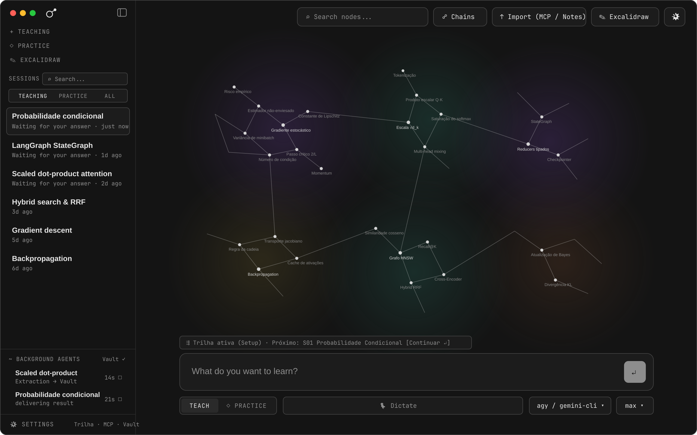
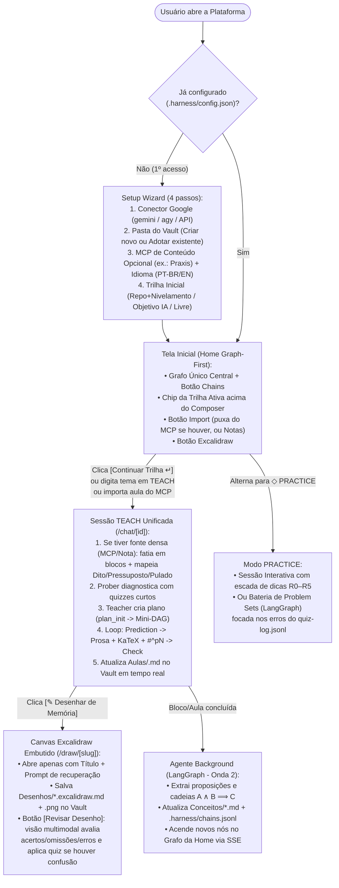

# Lapidare — Contexto do Projeto e Especificação de Comportamento (`CONTEXT_AND_BEHAVIOR.md`)

> [!IMPORTANT]
> Este documento define o **contexto de produto** e o **comportamento exato esperado** de todas as superfícies da plataforma (Onboarding/Setup, Home, Sessão `TEACH` Unificada, `QuestionDock`, `Excalidraw` Embutido, `PRACTICE` e Sincronização com o Vault).

---

## 1. Contexto: O Problema e a Visão do Produto

### 1.1 O Elo entre `ai-engineer` e `learnharness`
O método de estudo que deu origem ao seu ambiente atual (`~/Study/ai-engineer`) e ao repositório `amosblomqvist/learnharness` partiu de dois princípios pedagógicos verificados na prática:
1. **Ancorar o novo no que o aprendiz já sabe**, partindo sempre de um exemplo concreto e linguagem simples antes de introduzir formalismo matemático ou jargão.
2. **Verificar o entendimento de verdade (nunca perguntando *"entendeu?"*)**, exigindo previsão (*prediction*), cálculo ou decisão concreta com calibração explícita de confiança.

No entanto, cada sistema evoluiu metade da solução ideal:
- O seu sistema **`ai-engineer`** desenvolveu uma metodologia poderosa para engenharia de IA: **Trilha integrada `2:1`** (combinando mentoria e base teórica), ingestão de aulas densas via **MCP** (mapeando *Dito / Pressuposto / Pulado / Simplificações* com citações `#^pN`), prática de código e consolidação desenhando de memória no **Excalidraw** sobre um Vault real no Obsidian. Porém, a interface ficava espalhada entre terminal, popups `curses` (`quiz.py`) e janelas soltas.
- O **`learnharness`** criou uma interface web/desktop exemplar (prosa editorial em `CMU Serif` + `Source Sans 3` + `KaTeX` sobre grafite `#141414`, grafo global em Canvas 2D, `QuestionDock` inline com slider de confiança `0–100%` e campo *Your Thinking*, ditado por voz e pipelines de extração e `Practice`). Porém, trancou todos os dados em JSONs internos (`data/`), removeu o Vault/Excalidraw/Trilha `2:1`, e não possui suporte às assinaturas do ecossistema Google.

### 1.2 A Proposta da Nossa Plataforma (Lapidare)
Construir uma plataforma **local-first, bilíngue (`PT-BR` / `EN`) e pensada para a comunidade de usuários do ecossistema Google**, onde:
1. **O UX/UI segue o Design System do `learnharness`** (`#1a1430` / `#231b3e` / `#54458a`, `CMU Serif Bold`, `Source Sans 3` + KaTeX, `JetBrains Mono`), mas **sem proliferação de modos** (`TEACH` e `PRACTICE` apenas).
2. **Tudo roda utilizando a assinatura Google do próprio usuário** (`@google/gemini-cli` via ACP ou Google Antigravity `agy` via `stream-json`, com fallback opcional para API Key do Google AI Studio / Vertex AI).
3. **Tudo vive simultaneamente na UI e no Vault Markdown/Obsidian (`UI ⇄ Vault`)**: quem já usa Obsidian continua lendo/editando suas notas e desenhos normalmente; quem baixa a plataforma sem nunca ter usado Obsidian ganha um Vault estruturado automaticamente no disco e faz tudo pela UI Web (incluindo desenhar no `@excalidraw/excalidraw` embutido).

---

## 2. Design System ("The Skin") e Comparação Visual

### 2.1 Tokens Visuais Obrigatórios
- **Superfícies Acromáticas:**
  - Fundo principal (`--background`): `#1a1430`
  - Cards e docks elevados (`--card`): `#231b3e`
  - Hover / item selecionado (`--accent`): `#30255a`
  - Bordas de `1px` (`--border`): `#54458a`
  - Texto principal (`--foreground`): `#efeaff`
  - Rótulos e metadados silenciosos (`--muted-foreground`): `#a99cd0`
- **Tipografia:**
  - **Títulos (`--font-title`):** `CMU Serif Bold` (*Computer Modern*)
  - **Prosa Pedagógica (`--font-prose`):** `Source Sans 3` (`16px`, `line-height: 1.5`) + **KaTeX**
  - **Interface / Cromia (`--font-ui`):** `JetBrains Mono` (`11px` / `12.5px`, `letter-spacing: 0.06em`)
- **Ritmo Espacial:** múltiplos estritos de `4px` (`4 / 8 / 12 / 16px`), sem anel de foco nativo do navegador (`*:focus { outline: none }`).

### 2.2 Referência da Home Adaptada (Sem Ambiguidade de Modos)

*(Para comparação direta com a tela original do `learnharness`, veja também [`assets/mockup-lh-1-fiel.png`](assets/mockup-lh-1-fiel.png)).*

---

## 3. Especificação Comportamental Ponta a Ponta

---

### 3.1 Comportamento no Primeiro Acesso (`SetupDialog` / Onboarding)

Enquanto `.harness/config.json` não estiver configurado, qualquer tentativa de enviar um tema no composer intercepta o envio (preservando o texto digitado) e abre o modal de **Setup Inicial** em 4 etapas:

#### Etapa 1 — Conector do Ecossistema Google e Slots de Modelo
O backend escaneia a máquina (`detector.py`) e mostra o status de cada conector:
1. **`Gemini CLI` (`@google/gemini-cli`) — *Login with Google*:**
   - Detecta o binário `gemini` e verifica se há login Google ativo (Free, Google One AI Pro, AI Ultra ou Workspace Code Assist).
   - Se não estiver logado, exibe o comando/botão para autenticar.
2. **`Google Antigravity CLI` (`agy`):**
   - Detecta o binário `agy` no `PATH` e lista os modelos disponíveis.
3. **`Google AI Studio / Vertex AI` (`google-genai` SDK):**
   - Campo opcional para inserir `GEMINI_API_KEY` ou credenciais ADC do Vertex AI.

O usuário confirma os **3 slots de modelo** (`Strong` para Prober/Teacher/Practice/Visão, `Fast` para resumos/títulos, e `Background` para os pipelines `LangGraph`).

#### Etapa 2 — Idioma e Pasta do Vault (`UI ⇄ Vault`)
1. O usuário seleciona o idioma padrão da interface e das aulas: **`Português (PT-BR)`** ou **`English (EN)`**.
2. O usuário escolhe a pasta do seu Vault no disco (ex.: `/home/lazarodiza/Documents/AI Engineering` ou aceita o caminho padrão `~/Documents/StudyVault`):
   - **Caso A — Usuário não possui Vault (pasta não existe ou está vazia):**
     A aplicação cria a pasta e inicializa automaticamente toda a árvore de diretórios e templates de acordo com o idioma escolhido:
     - Em `PT-BR`: `00 Mapa.md`, `Aulas/`, `Conceitos/`, `Fontes/`, `Desenhos/`, `Templates/`, `viz/`, `.harness/`.
     - Em `EN`: `00 Map.md`, `Lessons/`, `Concepts/`, `Sources/`, `Drawings/`, `Templates/`, `viz/`, `.harness/`.
   - **Caso B — Usuário já possui um Vault (ex.: seu Vault atual no Obsidian):**
     A aplicação inspeciona as pastas existentes, cria apenas o diretório oculto `.harness/`, registra o mapeamento dos nomes das pastas em `.harness/config.json` e indexa os arquivos `Conceitos/*.md` e `Aulas/*.md` existentes sem modificar uma única linha do conteúdo do usuário.

#### Etapa 3 — Conectores MCP de Fonte (Opcional)
- Permite ativar ou adicionar servidores MCP de conteúdo (por exemplo, o **MCP do Praxis** `mcp__praxis__*`).
- Quando um MCP de conteúdo está registrado aqui, o botão **`↑ Import`** da Home passa a se conectar a ele automaticamente para listar aulas, lives, desafios e gabaritos disponíveis.

#### Etapa 4 — Configuração da Trilha Inicial (`Track`)
A trilha é configurada aqui no início para que o **próprio Harness conduza o aluno** dali em diante:
- **Opção 1 — Repositório / Curso Local + Nivelamento Adaptativo:** o usuário aponta para um repositório local de curso (ex.: `curriculum/` do `ai-engineering-from-scratch`) e/ou ativa o sincronismo com as semanas do MCP (ex.: Praxis). Se já houver um `LEARNING.md` / `00 Mapa.md`, o sistema adota a fila imediatamente; se não houver, inicia o **Nivelamento por Busca Binária** para encontrar a fronteira do aluno em cada vertente e gerar o roteiro integrado no ritmo `2:1` (etapa principal + 1–2 aulas de base).
- **Opção 2 — Trilha Gerada por Objetivo:** o usuário descreve o que deseja dominar (ou cola uma ementa/programa) e o Harness estrutura as etapas no `00 Mapa.md`.
- **Opção 3 — Sem Trilha Fixa:** o usuário estuda por tópicos livres ou importações avulsas, podendo configurar uma trilha depois em `Settings`.

---

### 3.2 Comportamento da Tela Inicial (`Home`)

1. **Visualização Central Única (O Grafo):**
   - Não há botão `Macro | Micro`. O centro da tela é ocupado integralmente pelo **Grafo de Conhecimento** em Canvas 2D (`#1a1430`), com *clusters* nebulosos suaves agrupando nós correlatos.
   - Clicar num nó abre seu card contextual (`#231b3e`, borda `#54458a`) com o resumo do conceito, suas dependências, o caminho da nota `Conceitos/<Nome>.md` no Vault e ações rápidas (`[ Abrir Nota ]`, `[ + Practice ]`, `[ ✎ Desenhar ]`).
   - O botão **`☍ Chains`** no topo abre a visualização em tabela das proposições e implicações lógicas ($A \land B \implies C$), permitindo filtrar e selecionar itens para estudo ou prática.

2. **Comportamento do Botão `↑ Import` (Guiado por MCP):**
   - Ao clicar em **`↑ Import`** no topo direito:
     - **Se houver um MCP configurado (ex.: Praxis):** o modal abre direto no catálogo do MCP, mostrando quais aulas/transcrições são novas e permitindo importá-las para `Fontes/Mentoria/` e já abrir a sessão `TEACH` correspondente em 1 clique. Uma segunda aba permite importar arquivos/notas locais (`.md`, `.txt`, `.pdf`).
     - **Se não houver MCP configurado:** abre diretamente o importador de notas, transcrições coladas ou arquivos locais.

3. **Como o Harness Conduz o Aluno pela Trilha:**
   - Quando o usuário possui uma Trilha ativa configurada no Setup, **não existe um botão "Modo Trilha"** separado dos modos `TEACH` e `PRACTICE`.
   - Em vez disso, o Harness exibe um *chip* contextual discreto logo acima do composer principal:
     `⇶ Trilha ativa · Próximo: <Título da Etapa / Aula>   [Continuar ↵]`
   - Clicar em `[Continuar ↵]` (ou pressionar o atalho) inicia ou retoma imediatamente a sessão **`TEACH`** daquele passo da trilha, já com todas as fontes e pré-requisitos carregados.

4. **Sidebar Esquerda Recolhível:**
   - Ações rápidas no topo: `+ TEACHING`, `◇ PRACTICE`, `✎ EXCALIDRAW`.
   - Busca de sessões (`⌕ Search...`) e filtro segmentado idêntico ao `learnharness`: **`TEACHING | PRACTICE | ALL`**.
   - Lista de sessões indicando estado em tempo real (`Waiting for your answer`, `Teaching...`, `Completed`).
   - Rodapé `~ BACKGROUND AGENTS` mostrando jobs ativos de extração/prática e acesso a `⚙ SETTINGS`.

---

### 3.3 Comportamento da Sessão `TEACH` Unificada (`/chat/[id]`)

O modo **`TEACH`** absorve de forma transparente o que antes eram fluxos separados (`/teach`, `/mentoria` e `/curriculo`). O comportamento se adapta automaticamente conforme o contexto da sessão:

#### Caso 1 — Sessão `TEACH` sobre uma Fonte Densa (Aula do MCP Praxis, Transcrição ou PDF em `Fontes/`)
1. **Ingestão e Mapeamento Estrutural:**
   - O agente lê o arquivo em `Fontes/` (cujos parágrafos são numerados como `^p1`, `^p2`, ..., `^pN`).
   - Divide a aula em **blocos lógicos** no `plan_init` (que aparecem no mini-DAG `PlanWindow` no canto inferior direito da tela).
   - Para cada bloco, mapeia internamente e na nota da aula (`Aulas/.../*.md`) quatro dimensões:
     - **O que foi dito** (resumo fiel com links `[[Fonte#^pN]]`);
     - **O que foi pressuposto** (conceitos que o instrutor assumiu que você já sabia sem explicar);
     - **O que foi pulado** (saltos lógicos ou matemáticos da explicação original);
     - **Simplificações / Divergências** (onde a explicação simplificou demais ou divergiu da teoria rigorosa).
2. **Triagem Inicial por Quiz (`Prober`):**
   - O `Prober` aplica 1–2 questões rápidas via `QuestionDock` por bloco (sempre incluindo a opção *"Não sei — me ensina"*).
   - Blocos em que o aprendiz acerta com confiança calibrada ($\ge 70\%$) são marcados como dominados no mini-DAG; blocos com erro, baixa confiança ou *"Não sei"* entram na fila de ensino detalhado do `Teacher`.
3. **Re-explicação Bloco a Bloco Ancorada (`Teacher`):**
   - O `Teacher` ensina cada bloco restante preenchendo os *pressupostos* e *pulos* antes de chegar na conclusão da aula, citando os parágrafos da fonte (`[[Fonte#^p14]]`).
   - Clicar em qualquer citação `#^pN` na UI abre um painel lateral mostrando o parágrafo exato da transcrição original destacado.

#### Caso 2 — Sessão `TEACH` conduzida pela Trilha (`2:1` / Currículo)
1. O agente carrega o item atual da fila (`00 Mapa.md` / `LEARNING.md`), seja ele uma semana da mentoria ou uma aula do currículo (`curriculum/phases/<fase>/<aula>/docs/en.md`).
2. Conecta explicitamente o conteúdo novo aos conceitos que o aluno já estudou na trilha.
3. Quando a aula envolve implementação prática, orienta o aluno a escrever o código em `pratica/<fase>/<aula>/` (nunca alterando `curriculum/`), verificando o entendimento linha a linha e com quizzes de mecanismo.
4. Ao concluir todos os nós do mini-DAG da aula, marca o item como concluído na Trilha e avança automaticamente o ponteiro da fila para o próximo passo do roteiro `2:1`.

#### Caso 3 — Sessão `TEACH` de Tópico Livre
1. O **`Prober`** faz um diagnóstico curto (1–3 quizzes via `QuestionDock`) para mapear o que o aluno já sabe sobre o tema e seus pré-requisitos.
2. Ao encontrar a fronteira do conhecimento, entrega o controle para o **`Teacher`**, que chama `plan_init` (criando o mini-DAG da aula) e conduz o ciclo `Prediction → Explicação (Exemplo concreto antes da definição + KaTeX + Diagrama) → Check`.

---

### 3.4 Comportamento do `QuestionDock` (Quizzes, Confiança e Raciocínio)

Toda pergunta com resposta certa acontece exclusivamente dentro do componente **`QuestionDock`** (nunca como pergunta solta no texto):

1. **Dois Modos de Cartão:**
   - **`PREDICTION` (Sempre aberto):** lançado *antes* de ensinar um passo chave para forçar o cérebro a prever o comportamento ou descobrir onde a abordagem ingênua quebra.
   - **`CHECK` (Inicia recolhido como pílula):** lançado *depois* da explicação para que o aluno leia a prosa e as fórmulas no seu tempo e clique para abrir o teste quando estiver pronto.
2. **Controles Obrigatórios do `QuestionDock`:**
   - Enunciado claro + **2 a 6 alternativas** (com suporte total a **KaTeX**) + opção final fixa **`"I don't know / Não sei"`**.
   - **Slider `CONFIDENCE` (`0%` a `100%`)**: mede a certeza subjetiva do aluno na resposta escolhida.
   - **Campo `YOUR THINKING`**: caixa de texto livre (com suporte a ditado por voz `🎙`) onde o aluno explica em 1 linha *por que* escolheu aquela opção.
3. **Matriz de Calibração e Reação do Agente:**
   Ao enviar a resposta, o backend avalia o par `(Acerto/Erro, Confiança %)` e grava em `.harness/quiz-log.jsonl`:
   - **Acerto + Confiança $\ge 70\%$ (`Calibrado`):** confirma em 1 frase curta e avança para o próximo nó do plano.
   - **Erro + Confiança $\ge 70\%$ (`Ilusão de Competência`):** alerta máximo! O agente lê o campo *Your Thinking*, mostra um contra-exemplo concreto onde a premissa do aluno falha, re-explica pelo ângulo oposto e lança um novo quiz antes de avançar.
   - **Acerto + Confiança $< 50\%$ (`Intuição Frágil`):** valida o raciocínio do aluno e solidifica o elo que deixava ele inseguro.
   - **Erro + Confiança $< 50\%$ ou `"Não sei"` (`Lacuna Consciente`):** volta um degrau nos pré-requisitos e constrói o conceito do zero sem jargão.

---

### 3.5 Comportamento do `Excalidraw` Embutido e Revisão por Visão (`/draw/[slug]`)

1. **Início do Desenho de Memória (*Retrieval Practice*):**
   - Ao concluir uma aula (ou clicar em `✎ Excalidraw`), o sistema cria `Desenhos/YYYY-MM-DD-<slug>.excalidraw.md` contendo **apenas o título e o prompt do que desenhar de memória** (sem respostas prontas), com links no frontmatter para a aula (`Aulas/...`) e os conceitos (`Conceitos/...`).
2. **Edição Bidirecional (`UI Web ⇄ Obsidian`):**
   - Na UI da plataforma, o componente `@excalidraw/excalidraw` abre em tema escuro (`#1a1430`), pronto para a mesa digitalizadora.
   - Cada salvamento grava o JSON Excalidraw dentro do arquivo `.excalidraw.md` e exporta automaticamente a imagem `Desenhos/YYYY-MM-DD-<slug>.png` — mantendo 100% de compatibilidade se você abrir o mesmo arquivo no Obsidian.
3. **Botão `[ Revisar meu desenho ]`:**
   - Dispara uma chamada multimodal passando o `.png` do desenho do usuário + o mapa de dependências e notas da aula.
   - O agente devolve um diagnóstico estruturado em 3 partes (**O que está correto**, **O que faltou**, **O que está incorreto**).
   - Se houver qualquer erro conceitual no desenho (ex.: direção de gradiente invertida, divisão por $\sqrt{d_k}$ no lugar errado), o agente abre imediatamente um **`QuestionDock`** focado naquele ponto e anexa o resumo da revisão na nota do desenho no Vault.

---

### 3.6 Comportamento do Modo `PRACTICE` (Treino Frio)

Quando o usuário seleciona `◇ PRACTICE` na Home ou na Sidebar:
1. **Alvos Priorizados por Evidência:**
   - Se o usuário não especificar nós manualmente, o sistema consulta `.harness/quiz-log.jsonl` e `.harness/chains.jsonl` para priorizar conceitos onde houve **Ilusão de Competência** (erro com alta confiança), baixa cobertura ou maior tempo desde a última revisão.
2. **Sessão Interativa (`R0–R5` Hint Ladder):**
   - O agente propõe um problema prático (*Recall*, *Discrimination* ou *Composition* / código).
   - Se o aluno errar ou pedir ajuda, o agente **nunca entrega a resposta**: ele sobe um degrau por vez na escada de dicas (`R0`: isolar a variável/sub-problema $\rightarrow$ `R1`: lembrar a definição $\rightarrow$ `R2`: testar caso limite $N=2$ $\rightarrow \dots \rightarrow$ `R5`).
3. **Baterias de *Problem Sets* (`LangGraph` — Onda 2):**
   - Gera listas fechadas de exercícios em paralelo (`Send`), exigindo que cada subagente gerador escreva a solução completa e a rubrica de pontuação *antes* de publicar o enunciado (*commit-before-pose*), e corrige as respostas do aluno com nota `0–10` por critério.

---

### 3.7 Comportamento da Sincronização Bidirecional (`UI ⇄ Vault`)

1. **Como a UI e o Obsidian Coexistem Sem Conflitos:**
   - `Fontes/**`: estritamente **somente-leitura** para a plataforma (nunca editado após importado).
   - `Aulas/**/*.md` e `Conceitos/*.md`: o parser de Markdown (`markdown_ast.py`) identifica as seções geradas pelo Harness e faz *merge* cirúrgico apenas nelas; qualquer bloco, callout ou seção livre criada pelo usuário no Obsidian é 100% preservada.
   - `watchfiles` no backend monitora a pasta do Vault: se você editar e salvar um `.md` ou `.excalidraw.md` no Obsidian, o backend emite um evento SSE (`vault:changed`) em milissegundos e a UI Next.js reflete a mudança na hora sem precisar dar F5.
